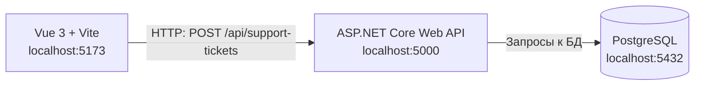

# Архитектура web-ИС

## Схема из трёх узлов



**Это и есть архитектура web-ИС семестра.**

Vue отображает формы и список. ASP.NET Core проверяет данные, права и переходы статусов. PostgreSQL хранит заявки, оборудование, клиентов и пользователей. Браузер обращается только к API, чтобы серверные правила нельзя было обойти прямой записью в БД.

## Пример запроса

```http
POST /api/support-tickets HTTP/1.1
Host: localhost:5000
Content-Type: application/json

{
  "title": "Не печатает сетевой принтер",
  "equipmentId": 7,
  "description": "После отправки задания документ не появляется в очереди принтера"
}
```

Сервер определяет вошедшего диспетчера, проверяет оборудование и сохраняет `SupportTicket` со статусом `New`. Ответ — `201 Created`, заголовок `Location: /api/support-tickets/17` и созданная заявка с техническим `id` и номером `number`.
