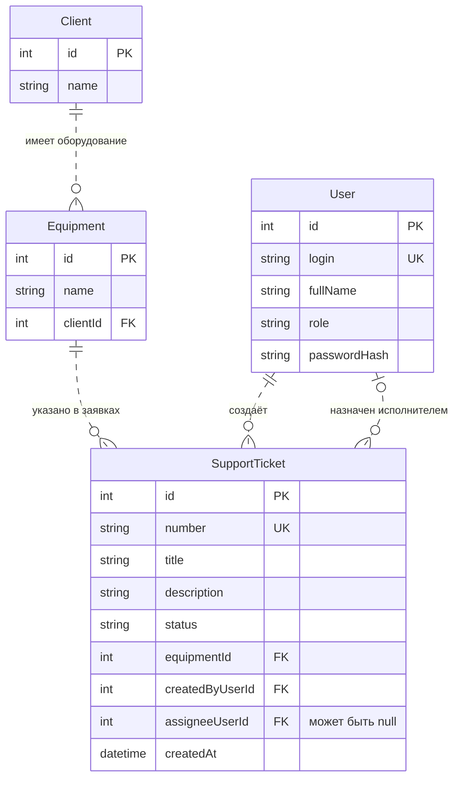

# Модель данных

## Словарь проекта

| Термин курса | Термин моей темы |
|---|---|
| Ticket | Заявка технической поддержки (`SupportTicket`) |
| Site | Оборудование (`Equipment`) |
| User | Сотрудник системы: диспетчер или инженер (`User`) |
| Организация-клиент | Получатель услуги (`Client`) |

## ER-диаграмма

**Связи словами:**

- У одного клиента может быть много единиц оборудования; каждая единица относится к одному клиенту.
- По одной единице оборудования может быть много заявок; у каждой заявки есть одно оборудование.
- Один диспетчер может создать много заявок; у каждой заявки один автор.
- Один инженер может исполнять много заявок; у заявки может быть ноль или один исполнитель.
- Организация-клиент заявки определяется через `SupportTicket.equipmentId → Equipment.clientId → Client.id`.

## Ключи

| Сущность | Первичный ключ (PK) | Внешние ключи (FK) | Уникальные поля (UK) |
|---|---|---|---|
| Client | id | — | — |
| Equipment | id | clientId → Client.id | — |
| User | id | — | login |
| SupportTicket | id | equipmentId → Equipment.id; createdByUserId → User.id; assigneeUserId → User.id | number |

`Equipment.clientId`, `equipmentId` и `createdByUserId` обязательны. `assigneeUserId` допускает `null`. Удаление используемого оборудования, клиента или пользователя не должно нарушать связи заявок. Перенос оборудования между клиентами не предусмотрен.

## Поля главного объекта

| Поле | Тип PostgreSQL | Обязательное | Смысл и ограничение |
|---|---|---|---|
| id | integer | да | Положительный технический ключ, формируется сервером |
| number | varchar(32) | да | Отдельный уникальный номер, например `SUP-2026-0001` |
| title | varchar(80) | да | Заголовок, 5–80 символов после удаления пробелов по краям |
| description | varchar(500) | да | Описание, 10–500 символов после удаления пробелов по краям |
| status | varchar(16) | да | Только `New`, `InProgress`, `Closed`, `Cancelled`; при создании `New` |
| equipmentId | integer | да | Положительная ссылка на существующее оборудование |
| createdByUserId | integer | да | Ссылка на вошедшего диспетчера; задаётся сервером |
| assigneeUserId | integer | нет | Ссылка на инженера; при создании `null` |
| createdAt | timestamp with time zone | да | Дата и время создания; задаются сервером, в API передаются в UTC |

У `Client` обязательны `id` и `name`; у `Equipment` — `id`, `name`, `clientId`; у `User` — `id`, `login`, `fullName`, `role`, `passwordHash`. Значения `User.role` — `Dispatcher` или `Engineer`. В `passwordHash` хранится хеш, а не пароль; это поле не включается в ответы API.

## Статусы и назначение

| Исходный статус | Действие | Кто выполняет | Результат |
|---|---|---|---|
| Записи ещё нет | Создание | Диспетчер | `New`, исполнитель отсутствует |
| New | Назначение или переназначение | Диспетчер | Меняется исполнитель, статус остаётся `New` |
| New | Взять в работу | Только назначенный инженер | InProgress |
| InProgress | Завершить | Только назначенный инженер | Closed |
| New или InProgress | Отменить | Диспетчер | Cancelled |

`Closed` и `Cancelled` — конечные состояния. Другие переходы и назначение после начала работы запрещены. Отмена сохраняет запись и назначенного исполнителя, если он был указан.

## Проверка 3НФ

Каждая сущность имеет отдельный ключ `id`; её неключевые атрибуты описывают только эту сущность. Название оборудования хранится в `Equipment`, название клиента — в `Client`, данные сотрудника — в `User`. В `SupportTicket` хранятся ссылки, а не копии этих названий и ФИО.

Поле `clientId` не дублируется в заявке: клиент определяется по `equipmentId`. Поэтому в заявке нет дополнительной зависимости `equipmentId → clientId` между неключевыми полями. Переименование клиента или оборудования выполняется в одной записи справочника.
