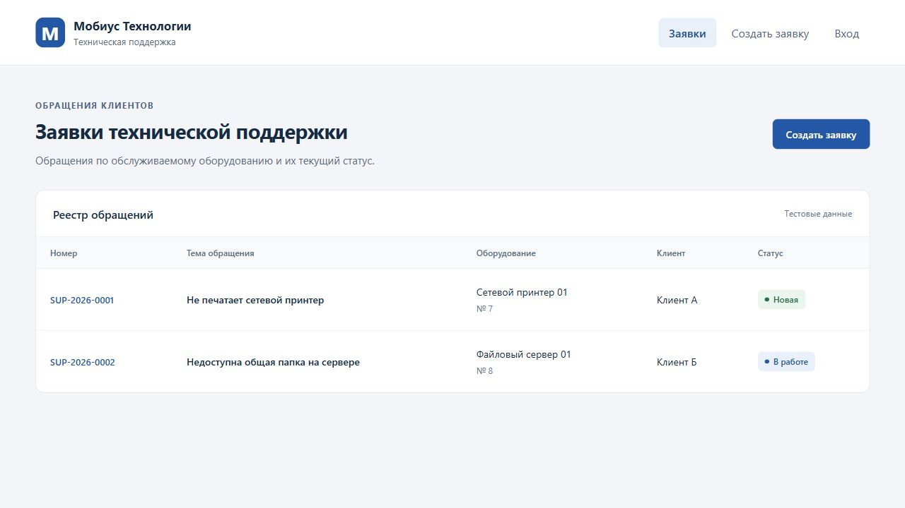
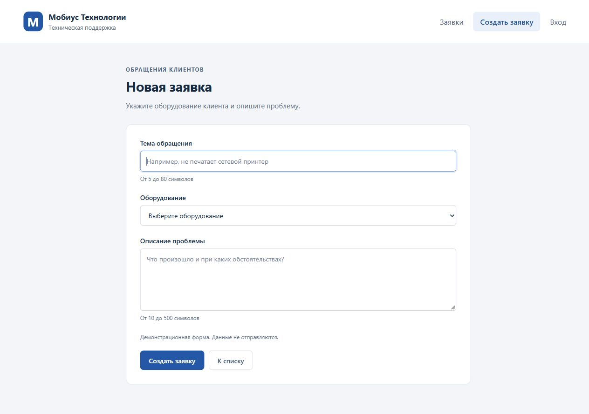
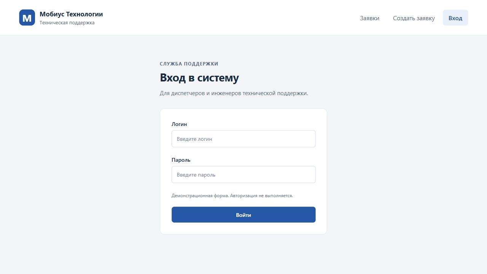

# ЛР3. Vue: каркас и экраны

Студент: Пантин Данил Денисович · Группа: ТРИС-2-23 · Дата: 17.10.2026

## Цель

Создать каркас клиентской части системы управления заявками на Vue 3 и JavaScript с тремя экранами: список, создание заявки и вход.

## Результат

Проект размещён в `frontend/` и запускается через Vite на порту 5173. Экраны переключаются через `ref` и `v-if` в `App.vue`. В таблице две тестовые заявки со статусами `New` и `InProgress`; строки выводятся через `v-for` с ключом `item.id`.

Поля `title`, `equipmentId`, `description` соответствуют критерию 1 ЛР1 и API-контракту ЛР2. Оборудование выбирается из тестового справочника. Формы создания и входа не отправляют данные; сохранение и авторизация не реализованы.

## Чеклист семантики

| № | Проверка | Да/нет |
|---|----------|--------|
| 1 | Рабочая область обёрнута в `main` | да |
| 2 | Создание и вход используют `form` | да |
| 3 | У каждого поля есть связанный `label` | да |
| 4 | Список оформлен как `table` | да |
| 5 | При открытии создания фокус получает поле `title` | да |
| 6 | У `v-for` есть `:key="item.id"` | да |
| 7 | Стили читаемы, подписи видны; стили компонента используют `scoped` | да |

## Проверка

- `npm install` выполнен без ошибок.
- `npm run build` завершён успешно.
- После остановки и повторного `npm run dev` приложение доступно на порту 5173.
- В браузере проверены три экрана при окне 1280×720; горизонтальной прокрутки страницы нет.
- Одновременно отображается один экран; после отправки форм клавишей Enter страница не перезагружается.
- Пароль отображается скрытыми символами, ошибок в консоли браузера нет.
- `node_modules` и `dist` исключены из Git.

## Список заявок

## Создание заявки

## Вход

