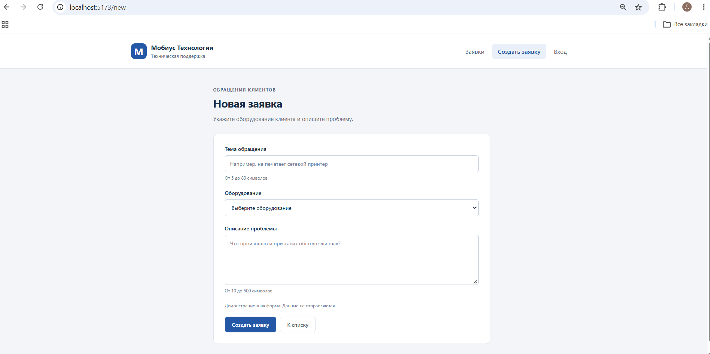

# ЛР4. Vue: компоненты и маршруты

Студент: Пантин Данил Денисович · Группа: ТРИС-2-23 · Дата: 17.10.2026

## Цель

Разделить клиентскую часть на компоненты и страницы, подключить Vue Router и вынести список заявок в общий модуль.

## Результат

В `main.js` подключён роутер с `createWebHistory`. Меню в `AppHeader.vue` использует `router-link`. Шапка расположена в `App.vue` снаружи `router-view` и отображается на всех страницах.

Таблица получает массив через props, источник — `ticketsStore.js`. Страница `TicketList.vue` импортирует общий `items` и передаёт его в `TicketTable.vue`. Таблица объявляет обязательный prop типа `Array`, не копирует и не изменяет массив.

| Адрес | Страница | Содержимое |
|-------|----------|------------|
| `http://localhost:5173/` | `TicketList.vue` | Таблица двух тестовых заявок |
| `http://localhost:5173/new` | `TicketNew.vue` | Поля `title`, `equipmentId`, `description` |
| `http://localhost:5173/login` | `Login.vue` | Логин и пароль |

## Структура файлов

```text
frontend/src/
├── main.js
├── App.vue
├── router.js
├── ticketsStore.js
├── assets/
│   └── main.css
├── components/
│   ├── AppHeader.vue
│   └── TicketTable.vue
└── pages/
    ├── TicketList.vue
    ├── TicketNew.vue
    └── Login.vue
```

## Схема компонентов

```text
App.vue
├── AppHeader
│   └── router-link: /, /new, /login
└── main
    └── router-view
        ├── /       → TicketList → TicketTable
        ├── /new    → TicketNew
        └── /login  → Login

ticketsStore.js → TicketList → props items → TicketTable
```

В `router-view` отображается одна страница, соответствующая текущему адресу.

## Проверка

- [x] Установлен `vue-router`, обновлены `package.json` и `package-lock.json`.
- [x] Три адреса проверены прямым открытием и обновлением в браузере.
- [x] После обновления `/new` отображается форма, `/login` — вход, `/` — список.
- [x] Меню использует `router-link`; переключение экранов через `v-if` удалено.
- [x] Есть `AppHeader.vue`, `TicketTable.vue` и три страницы в `pages/`.
- [x] На каждом маршруте одна шапка и одна рабочая область `main`.
- [x] Активный пункт меню соответствует адресу страницы.
- [x] При открытии `/new` фокус получает поле `title`.
- [x] У таблицы обязательный prop `items`; собственной копии списка нет.
- [x] Массив заявок находится в одном `ticketsStore.js`.
- [x] Pinia не используется.
- [x] `npm run build` завершается успешно.
- [x] `node_modules` и `dist` исключены из Git.
- [x] Добавлен скриншот `/new` с адресной строкой браузера.
- [x] Создан коммит ЛР4.

## Создание заявки


