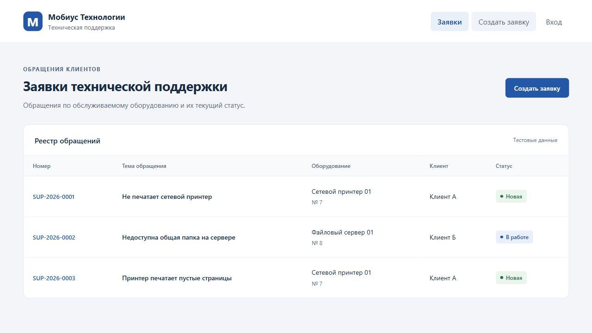
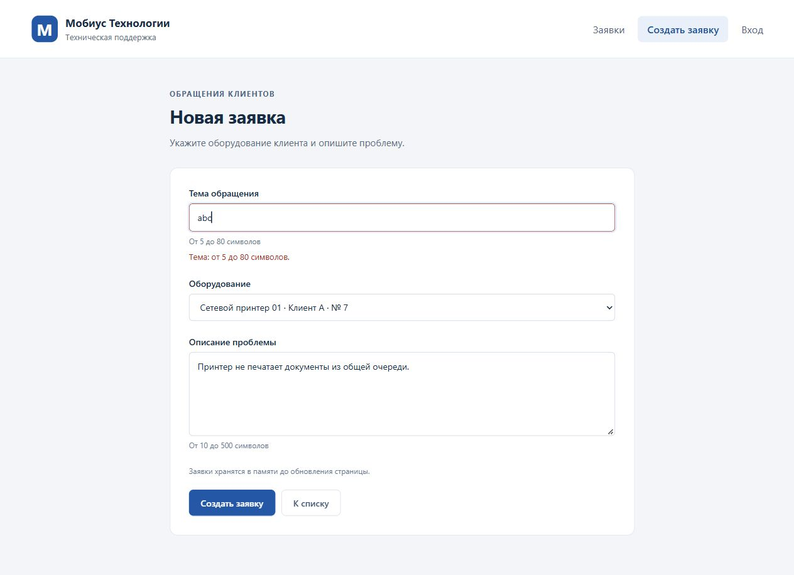

# ЛР5. Vue: форма и список в памяти

Студент: Пантин Данил Денисович · Группа: ТРИС-2-23 · Дата: 17.10.2026

## Цель

Связать форму создания заявки с общим массивом, проверять введённые данные и отображать новую запись в списке.

## Результат

В `TicketNew.vue` поля связаны с реактивным объектом через `v-model`, для `equipmentId` используется `.number`. Обработчик `@submit.prevent="onCreate"` проверяет данные и вызывает `addItem` из `ticketsStore.js`. Ошибки отображаются рядом с полями; при отказе введённые значения сохраняются.

Тема и описание очищаются от пробелов по краям. Тема должна содержать 5–80 символов, описание — 10–500. `equipmentId` должен быть целым положительным числом и соответствовать оборудованию из `equipment.js`. Название оборудования и организация-клиент определяются по выбранной записи справочника.

Функция `addItem` добавляет запись в единственный общий массив `items`. Новая заявка получает отдельные `id` и `number`, описание и статус `New`. Для исходных данных следующий ID — `19`, номер — `SUP-2026-0003`. После успеха форма и ошибки очищаются, выполняется переход на `/`. Повторная отправка во время перехода блокируется.

## Проверка трёх сценариев

| Проверка | Действие | Результат |
|----------|----------|-----------|
| Успех | Ввести тему «Принтер печатает пустые страницы», выбрать оборудование № 7, заполнить описание и нажать Enter | Открыт список; появилась третья строка `SUP-2026-0003` со статусом «Новая» и клиентом «Клиент А» |
| Отказ | Ввести тему `abc`, выбрать оборудование и заполнить описание | Под темой показана ошибка; запись не добавлена, в списке остались две исходные строки |
| Память | Обновить страницу списка после успешного создания | Добавленная заявка исчезла, остались две исходные строки. Ожидаемо: сервера и БД пока нет |

### Успешное создание

### Отказ при короткой теме

### Список после обновления страницы

## Чеклист

- [x] Все три поля связаны через `v-model`.
- [x] Для `equipmentId` используется `.number`.
- [x] Форма использует `@submit.prevent`.
- [x] Enter не перезагружает приложение.
- [x] У каждого поля есть связанный `label`.
- [x] После успеха форма очищается.
- [x] Тема после `trim` имеет 5–80 символов.
- [x] Тема короче 5 символов не добавляется.
- [x] `equipmentId` — целое число больше нуля.
- [x] Описание имеет 10–500 символов.
- [x] Ошибка показана рядом с соответствующим полем.
- [x] Новая запись получает `status: 'New'`.
- [x] Новый `id` не повторяется в текущей сессии.
- [x] Используется один массив из `ticketsStore.js`.
- [x] После успеха происходит переход на `/`.
- [x] Новая строка видна без ручной правки кода.
- [x] Двойное нажатие Enter проверено: добавилась одна запись.
- [x] После обновления страницы добавленная запись исчезает.
- [x] В отчёте есть успех, отказ и обновление страницы.
- [x] Сделан коммит ЛР5.

Дополнительно проверены пустая тема, тема из пробелов, длины темы 4 и 81, описания 9 и 501 символ; отправка без оборудования. Все случаи отклонены без добавления строк. Допустимые границы 5/80 и 10/500 символов приняты. Двойной клик по кнопке создаёт одну заявку. При повторном открытии формы поля и ошибки пусты. Проверка общего модуля подтвердила числовой тип `equipmentId`, уникальность ID и номеров, статус `New` и соответствие оборудования клиенту.

Сборка `npm run build` завершена успешно. Ошибок и предупреждений в консоли браузера нет.
