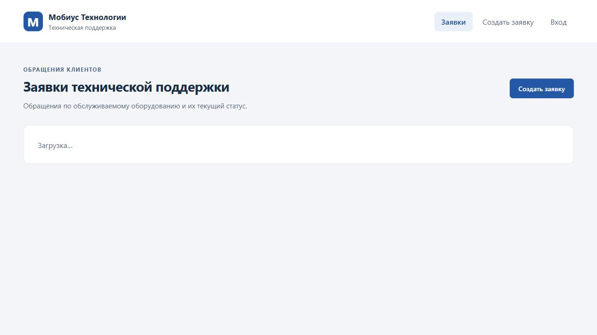
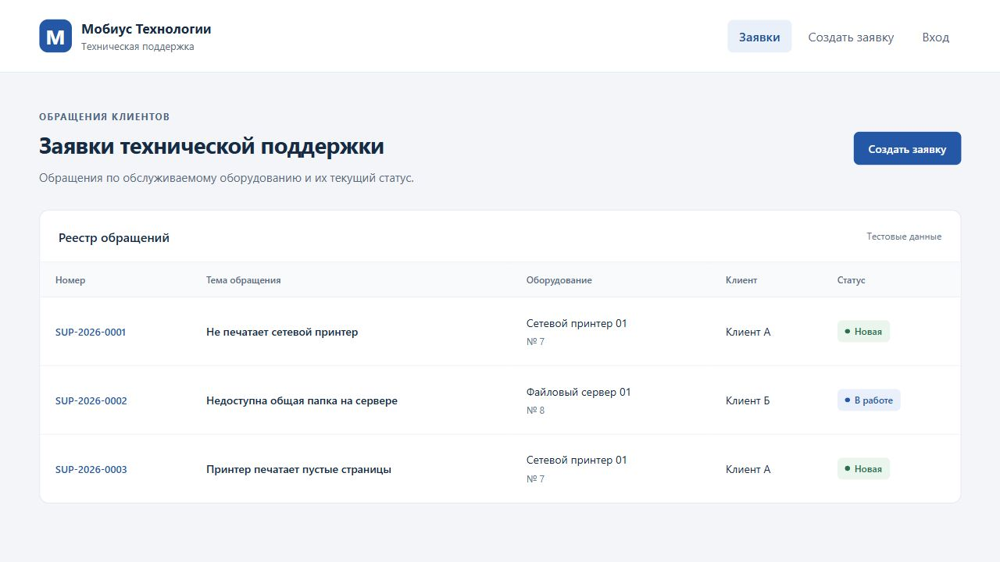
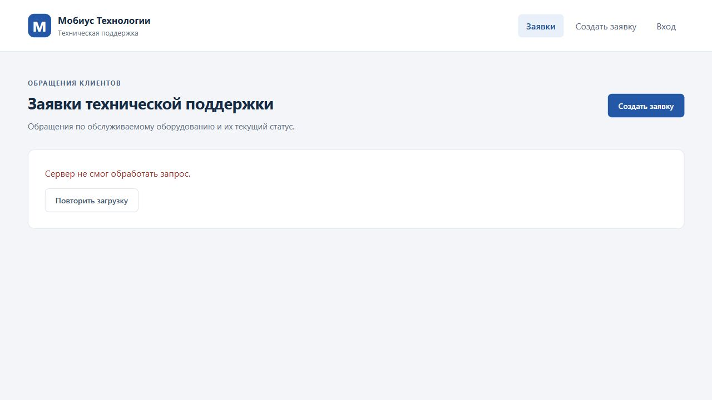
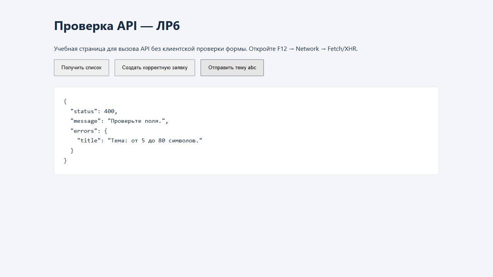
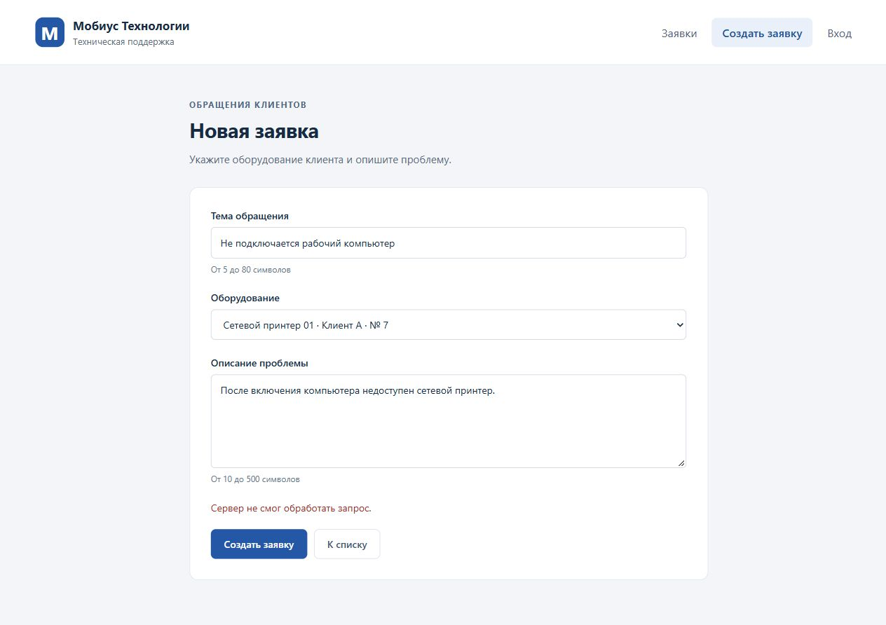
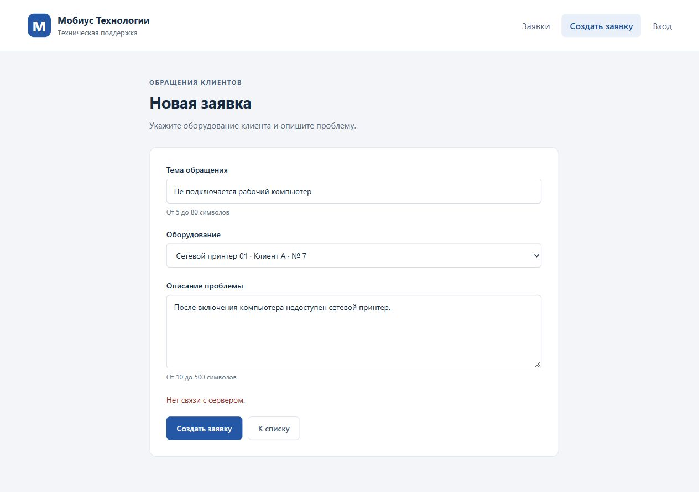
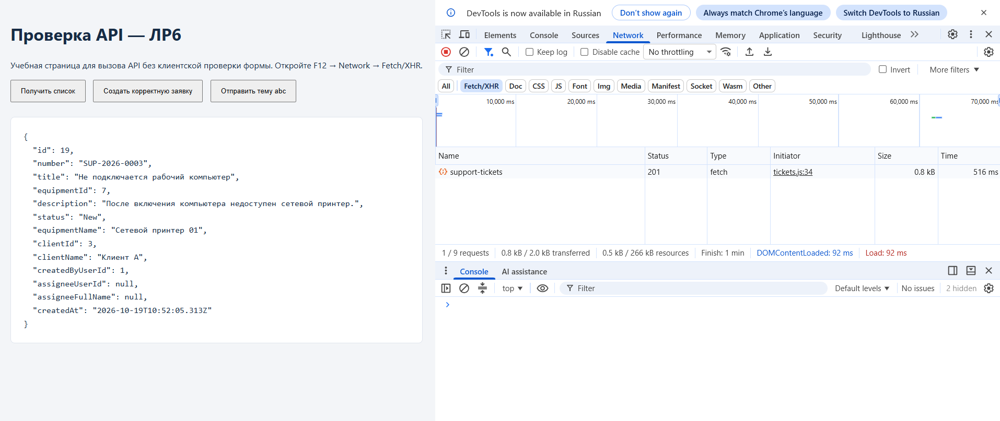
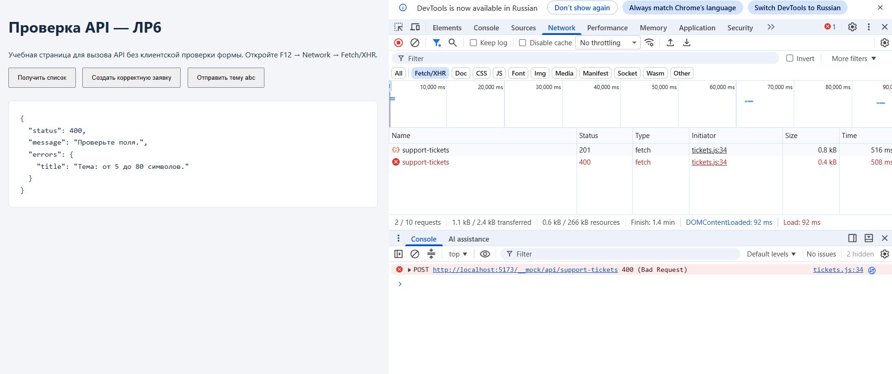

# ЛР6. Vue: клиент API и mock

Студент: Пантин Данил Денисович · Группа: ТРИС-2-23 · Дата: 19.10.2026

## Цель

Отделить страницы от источника данных, загружать и создавать заявки через API-модуль, отображать ожидание ответа и различать отказы.

## Результат

`src/api/tickets.js` экспортирует `getTickets()` и `createTicket(body)`. Страницы не знают URL и не импортируют mock. Адрес реального API читается из `VITE_API_BASE_URL`: `http://localhost:5000`. Локальный `.env` исключён из Git, `.env.example` включён в состав проекта. Используется встроенный `fetch`.

`src/api/mockTickets.js` хранит учебные записи и отвечает с задержкой 500 мс. При разработке `dev/mockApiPlugin.js` подключает его к Vite по адресу `/__mock/api/support-tickets`. Это настоящие HTTP-запросы к учебному mock. Реальная ветка API использует `/api/support-tickets` на порту 5000.

`TicketList.vue` вызывает `getTickets()` при открытии и показывает одно состояние: `loading`, `empty`, `data` или `error`. Полученный список сохраняется в `ticketsStore.js`, таблица получает его через props.

Форма сохраняет проверки ЛР5 и отправляет только `title`, числовой `equipmentId`, `description`. Она вызывает `createTicket()`, после успеха очищается и переходит на список с повторной загрузкой. `id`, `number` и статус берутся из ответа mock; страница их не вычисляет. Организация-клиент определяется по оборудованию. На время POST кнопка отключена и показывает «Создаём…»; повторный submit отклоняется. В `finally` блокировка снимается. При отказе поля остаются заполненными.

В HTTP-режиме записи хранятся в памяти dev-сервера: F5 повторно загружает их, перезапуск Vite сбрасывает. В production-сборке используется прямой JavaScript mock без HTTP, данные которого живут в памяти вкладки.

## Проверки

| Сценарий | Действие | Результат |
|----------|----------|-----------|
| Загрузка | Открыть `/` | «Загрузка…», таблица отсутствует до ответа |
| Пустой список | Открыть `/?mock=empty` | HTTP 200 и `[]`; «Заявок пока нет», таблицы нет |
| Данные | Открыть `/` без параметров | Таблица полученных заявок |
| Ошибка списка | Открыть `/?mock=500` | Отдельное сообщение и кнопка повторной загрузки |
| Создание | Заполнить форму корректными значениями | POST 201; после GET новая заявка видна в списке |
| Повторная отправка | Дважды нажать кнопку создания | Во время ожидания кнопка disabled; добавлена одна запись |

### Состояния списка

## Три отказа

| Отказ | Как воспроизвести | Что происходит | Текст человеку | Скрин результата |
|-------|-------------------|----------------|----------------|------------------|
| 400 | На `/dev/api-check.html` отправить тему `abc` | HTTP 400, `!response.ok`; ошибка содержит статус и ошибки полей | «Проверьте поля.» | есть |
| 500 | Отправить корректную форму на `/new?mock=500` | HTTP 500, `!response.ok` | «Сервер не смог обработать запрос.» | есть |
| Нет связи | На `/new?api=real` отправить форму при выключенном API | `fetch` отклоняется, HTTP-ответа нет; `catch`, статус `null` | «Нет связи с сервером.» | есть |

Короткую тему обычная форма отклоняет до запроса. Для проверки именно HTTP 400 используется отдельная учебная страница, которая вызывает тот же `createTicket()` без клиентского валидатора.

## Network

Учебный HTTP mock виден в Network → Fetch/XHR. На `/dev/api-check.html` кнопка «Создать корректную заявку» выполняет POST с ответом `201`, «Отправить тему abc» — POST с ответом `400`. Для просмотра отказа без ответа используется `/new?api=real`: запрос направляется к `http://localhost:5000/api/support-tickets`.

### Успешное создание: HTTP 201

В Network виден запрос `support-tickets` со статусом `201`; ответ содержит `id`, `number`, числовой `equipmentId` и `status: 'New'`.

### Отказ: HTTP 400

В Network виден запрос со статусом `400`, в ответе — «Проверьте поля» и ошибка длины темы. Красная запись в консоли относится к намеренно вызванному HTTP 400.

## Чеклист

- [x] Есть `frontend/.env.example`.
- [x] Адрес API — `http://localhost:5000`.
- [x] `.env` не отслеживается Git.
- [x] Есть `src/api/tickets.js`.
- [x] Есть `src/api/mockTickets.js`.
- [x] Экспортируются `getTickets` и `createTicket`.
- [x] Реальная ветка использует встроенный `fetch`.
- [x] Axios не устанавливался.
- [x] Список показывает загрузку.
- [x] Пустой список отличается от загрузки.
- [x] Данные показываются таблицей.
- [x] Ошибка показывается отдельно.
- [x] Во время создания кнопка disabled.
- [x] Двойной клик создаёт одну запись.
- [x] `id` и `number` берутся из ответа.
- [x] После отказа поля можно исправить.
- [x] HTTP 400 воспроизведён.
- [x] HTTP 500 воспроизведён.
- [x] Отсутствие связи воспроизведено.
- [x] Для трёх случаев показаны разные тексты.
- [x] Проверена ветка `!response.ok`.
- [x] Проверена ветка `catch`.
- [x] Есть скрин Network успеха.
- [x] Есть скрин Network отказа.
- [x] Сделан коммит ЛР6.

Проверки модуля mock подтвердили числовой `equipmentId`, проверки полей, отсутствие добавления при отказе, независимость возвращаемых копий и формирование `id`, `number`, `New` на стороне mock. Проверка API-модуля подтвердила сохранение HTTP-статусов 400/500, отсутствие HTTP-статуса при сетевой ошибке, адрес реального запроса, JSON-тело и передачу полученного ID без замены. HTTP-проверки подтвердили ответы 200/400/500 и отсутствие новых строк после отказов.

`npm run build` завершён успешно. В обычном успешном сценарии ошибок и предупреждений в консоли браузера нет. HTTP 400/500 и отсутствие связи воспроизведены намеренно для проверки отказов.
