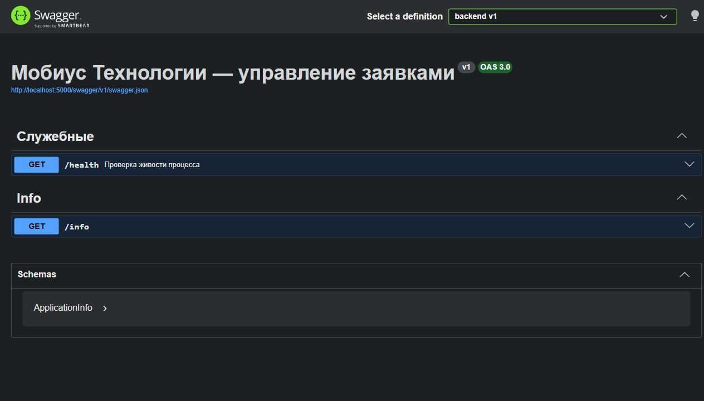
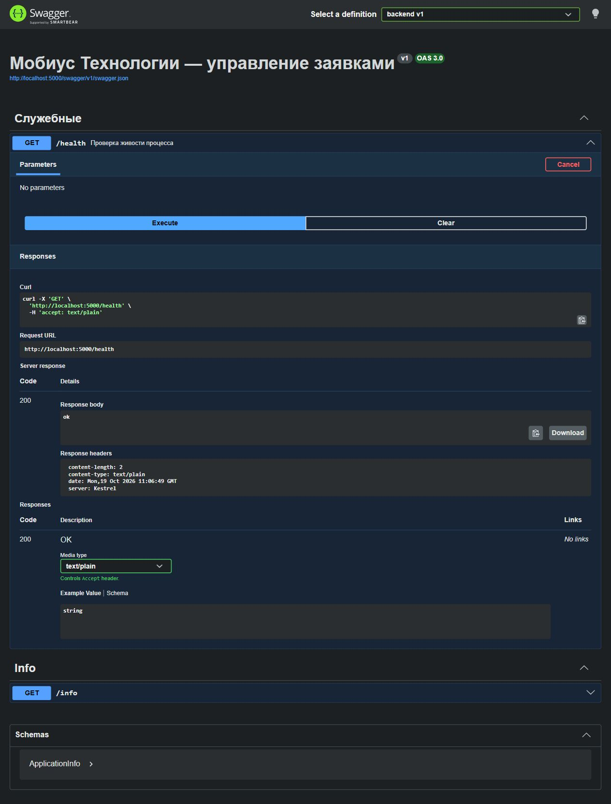
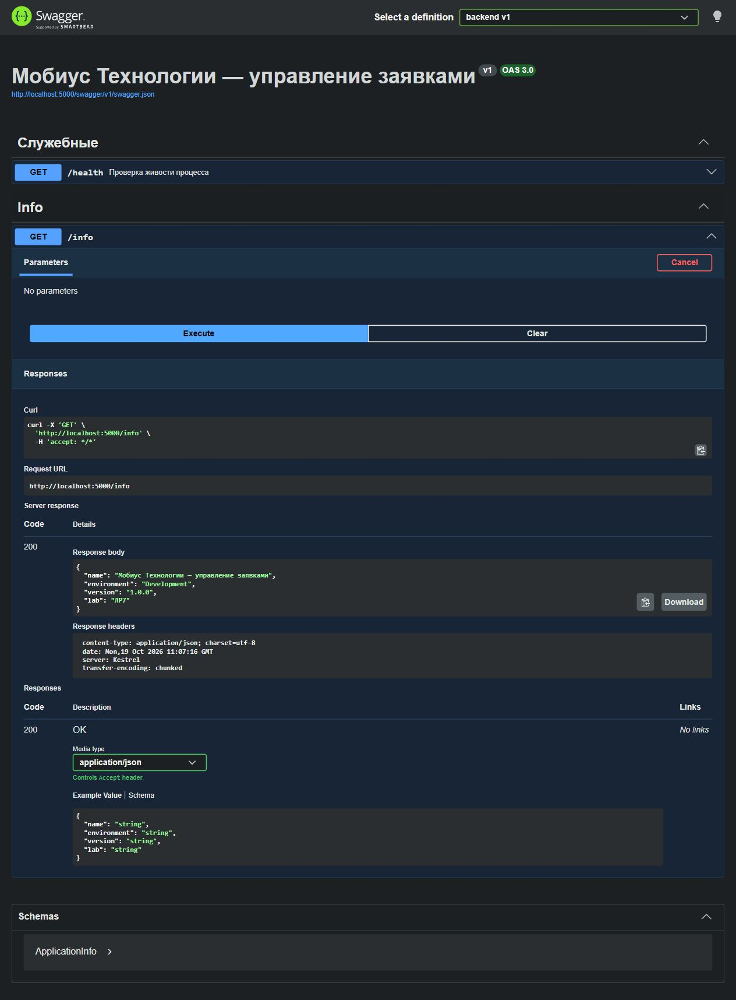

# ЛР7. ASP.NET Core: каркас Web API

Студент: Пантин Данил Денисович · Группа: ТРИС-2-23 · Дата: 19.10.2026

## Цель

Создать каркас ASP.NET Core Web API на порту 5000, подключить Swagger и внедрение зависимостей, проверить служебные адреса.

## Результат

В папке `backend/` создан проект на C# с целевой платформой `net9.0`. Использован .NET SDK 9.0.101. Профиль `http` в `Properties/launchSettings.json` задаёт `http://localhost:5000` и среду `Development`. Swagger подключён через Swashbuckle.AspNetCore и доступен в Development.

`GET /health` реализован как служебный Minimal API и возвращает `200` с текстом `ok`. `GET /info` обрабатывается `InfoController`: контроллер получает `IApplicationInfoService` через конструктор, вызывает сервис и возвращает название приложения, среду, версию и номер лабораторной.

Сервис зарегистрирован через DI, чтобы контроллер не создавал реализацию через `new`. В `Program.cs` используется `AddSingleton<IApplicationInfoService, ApplicationInfoService>()`.

Создание заявок в backend не реализовано и относится к ЛР8. Клиент Vue продолжает работать с mock ЛР6. PostgreSQL не подключён.

## Структура backend

```text
backend/
├── backend.csproj
├── backend.http
├── Program.cs
├── appsettings.json
├── appsettings.Development.json
├── Properties/
│   └── launchSettings.json
├── Controllers/
│   └── InfoController.cs
├── Services/
│   ├── IApplicationInfoService.cs
│   └── ApplicationInfoService.cs
├── Models/
│   └── ApplicationInfo.cs
└── Data/
    └── .gitkeep
```

## Проверка запуска

Команды `dotnet restore`, `dotnet build --no-restore` и `dotnet run` выполнены успешно. Сборка завершилась без предупреждений и ошибок. В терминале подтверждены `Now listening on: http://localhost:5000` и `Hosting environment: Development`.

Сервер остановлен, затем повторно выполнены команды README: `dotnet restore` и `dotnet run`. После повторного запуска Swagger открылся, запросы `/health` и `/info` проверены в браузере через Try it out → Execute.

| Проверка | Фактический результат |
|----------|-----------------------|
| `GET /swagger` | Перенаправление на страницу Swagger |
| `GET /swagger/index.html` | HTTP 200, интерактивные операции `/health` и `/info` |
| `GET /swagger/v1/swagger.json` | HTTP 200, описание двух GET; у `/health` нет параметров и тела запроса |
| `GET /health` | HTTP 200, `text/plain`, тело `ok` |
| `GET /info` | HTTP 200, JSON: название приложения, `Development`, `1.0.0`, `ЛР7` |
| `POST /health` с данными заявки | HTTP 405: этот метод не поддерживается |
| `POST /api/support-tickets` | HTTP 404: создание заявки ещё не реализовано |

### Swagger



### Ответ health



### Ответ info



## Чеклист: health ≠ создание заявки

| Утверждение | Да/нет |
|-------------|--------|
| `/health` возвращает 200 без тела заявки | да |
| `/health` не принимает поля `title`, `equipmentId`, `description` | да |
| Успешный `/health` не доказывает работу POST | да |
| Создание главного объекта относится к ЛР8 | да |
| README прямо объясняет это различие | да |
| Swagger и `/health` проверены отдельно | да |

## Чеклист

- [x] `dotnet --version` работает.
- [x] Проект расположен в `backend/` рядом с `frontend/`.
- [x] `dotnet restore` проходит.
- [x] `dotnet run` проходит.
- [x] HTTP-порт равен 5000.
- [x] Команды запуска записаны в README.
- [x] Самостоятельный запуск по README проверен студентом: Swagger открывается, `/health` возвращает 200 и `ok`, `/info` показывает сведения о приложении и среду Development.
- [x] Swagger открывается в Development.
- [x] `GET /health` возвращает 200.
- [x] `GET /info` возвращает сведения о приложении.
- [x] `/health` не принимает данные заявки.
- [x] Создание записи не выдано за готовое.
- [x] Подготовлена папка `Controllers` с контроллером.
- [x] Подготовлена папка `Services` с интерфейсом и реализацией.
- [x] Подготовлена папка `Models` с моделью ответа.
- [x] Подготовлена папка `Data` с `.gitkeep`.
- [x] Сервис зарегистрирован через DI.
- [x] `bin` исключён из Git.
- [x] `obj` исключён из Git.
- [x] В README есть точный адрес Swagger.
- [x] В README есть пояснение о данных в памяти и перезапуске.
- [x] В README объяснено, что `/health` проверяет только живость процесса.
- [x] Заполнен чеклист `health ≠ создание`.
- [x] Сделан коммит ЛР7.
