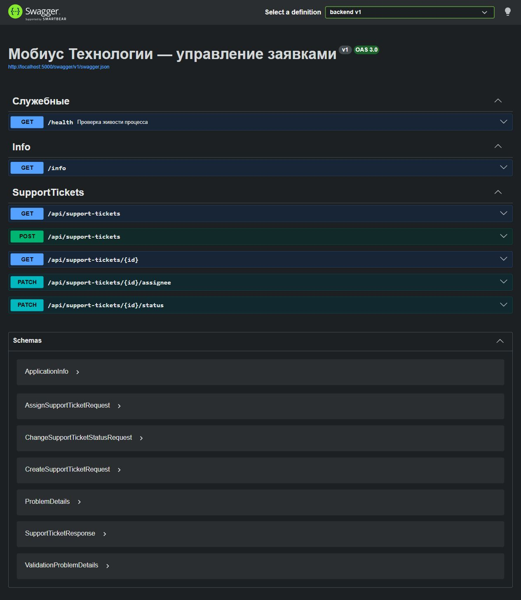
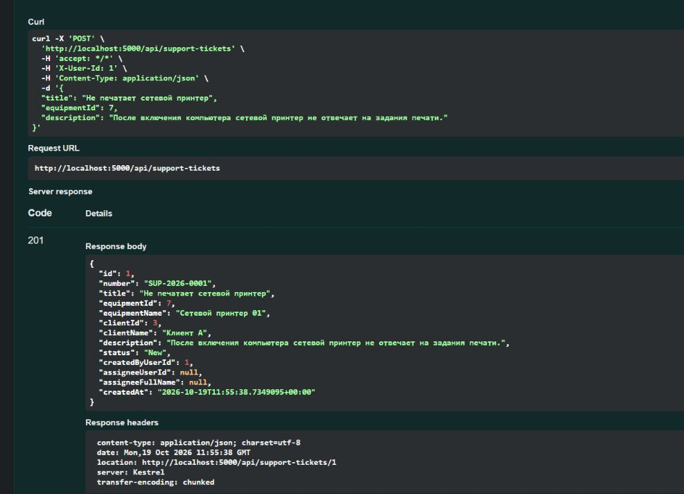
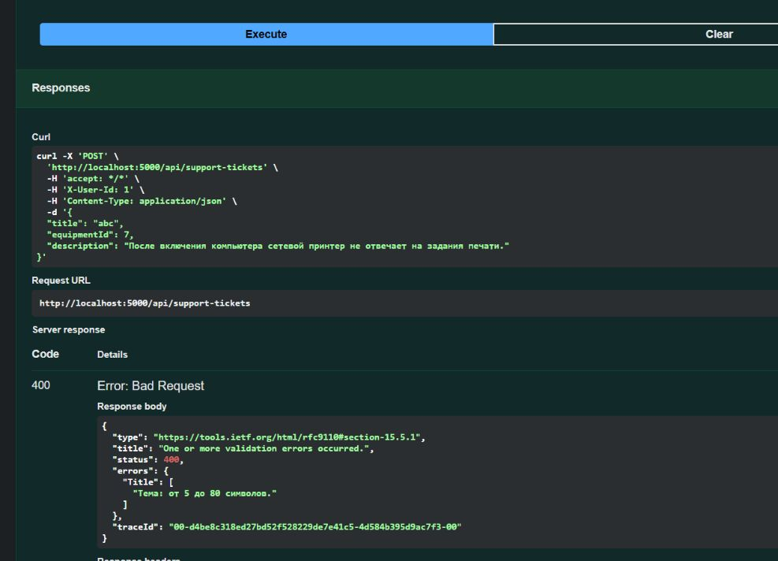
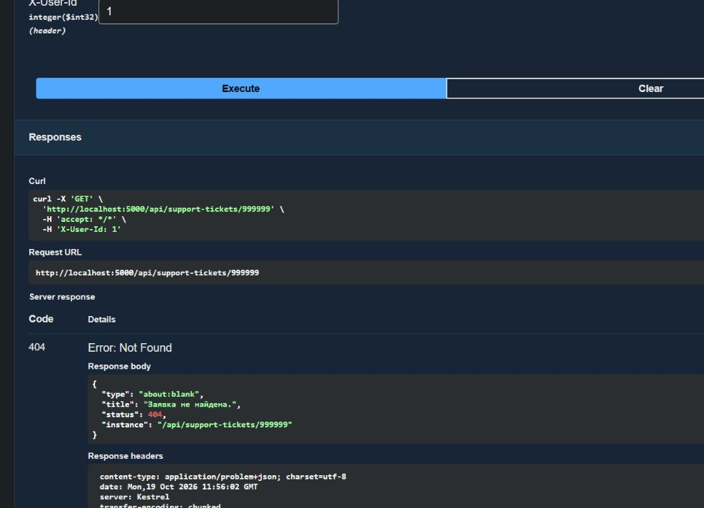
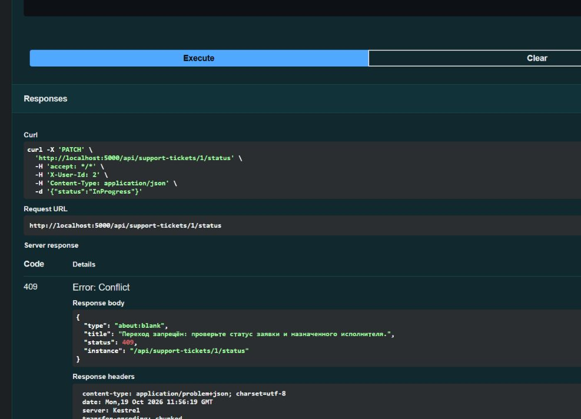
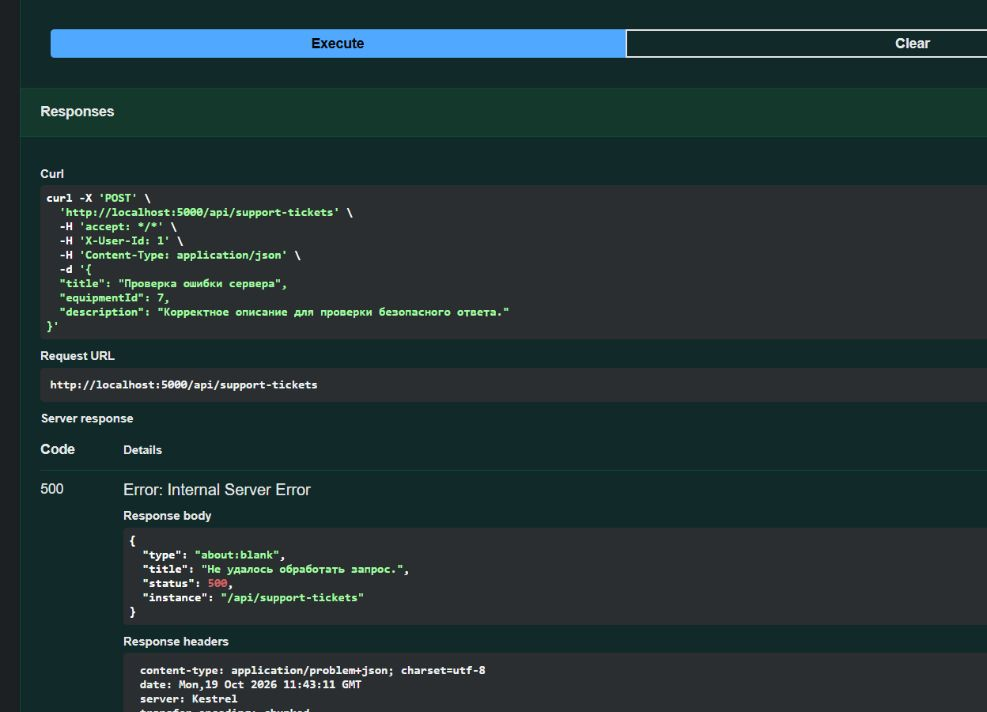
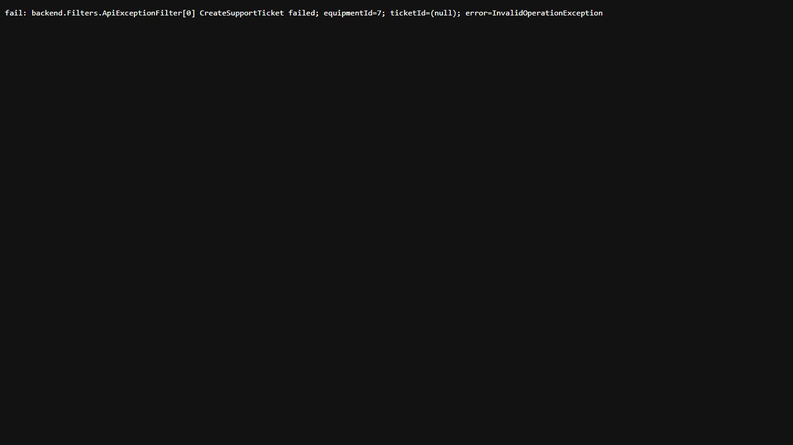

# ЛР8. REST: создание, чтение, назначение и статус

Студент: Пантин Данил Денисович · Группа: ТРИС-2-23 · Дата: 19.10.2026

## Цель

Реализовать REST API заявок технической поддержки: создание, чтение, назначение инженера и изменение статуса. Проверить валидацию, правила процесса и безопасную обработку ошибок.

## Результат

Главная сущность — `SupportTicket`, ресурс — `/api/support-tickets`. Данные хранятся в памяти singleton-сервиса `SupportTicketService`; после перезапуска backend список пуст. Контроллер принимает HTTP-запросы и вызывает сервис через `ISupportTicketService`, зарегистрированный в DI. Проверки полей описаны во входных DTO, правила назначения и переходов — в сервисе.

При создании передаются `title`, числовой `equipmentId` и `description`. Пробелы по краям текста удаляются перед проверкой: тема содержит 5–80 символов, описание — 10–500. Оборудование должно существовать в справочнике. Клиентская организация определяется через `Equipment.ClientId` и отличается от пользователя, создавшего заявку.

Сервер задаёт технический `id`, человекочитаемый `number` вида `SUP-2026-0001`, `New`, автора и время создания. Исполнитель при создании не назначен. Эти поля отсутствуют во входном DTO и не принимают значения, переданные клиентом.

| Метод и путь | Результат |
|--------------|-----------|
| `POST /api/support-tickets` | 201, созданная заявка и заголовок Location |
| `GET /api/support-tickets` | 200, список или `[]` |
| `GET /api/support-tickets/{id}` | 200, одна заявка; 404, если записи нет |
| `PATCH /api/support-tickets/{id}/assignee` | 200, назначен инженер, статус сохранён |
| `PATCH /api/support-tickets/{id}/status` | 200, выполнен допустимый переход |

Назначение принимает `{ "assigneeUserId": 2 }`, изменение статуса — `{ "status": "InProgress" }`. Для списка предусмотрен фильтр `?status=New`. DELETE и общий PATCH отсутствуют.

## Участники и правила процесса

В запросах используется временный заголовок `X-User-Id`: `1` — диспетчер, `2` и `3` — инженеры. Это способ указать действующего сотрудника до реализации входа. Некорректный или неизвестный ID возвращает 400; запрещённое действие сотрудника на этом этапе возвращает 409.

В справочнике оборудование `7` принадлежит клиенту `3` («Клиент А»), оборудование `8` — клиенту `4` («Клиент Б»).

| Действие | Кто выполняет | Условие |
|----------|---------------|---------|
| Создать заявку | Диспетчер | Корректные поля и оборудование |
| Назначить или переназначить инженера | Диспетчер | Статус New |
| New → InProgress | Назначенный инженер | Исполнитель уже назначен |
| InProgress → Closed | Назначенный инженер | Заявка находится в работе |
| New или InProgress → Cancelled | Диспетчер | Заявка ещё не завершена |

Closed и Cancelled неизменяемы. Отмена сохраняет запись и исполнителя. Инженер читает только назначенные ему заявки; фильтр по статусу не расширяет доступный список. Назначение инженера само по себе не начинает работу.

## Проверка

Сборка `dotnet build --no-restore` завершилась без предупреждений и ошибок. Сервер запущен на `http://localhost:5000` в Development, маршруты проверены через Swagger и HTTP-запросы.

[Коллекция Postman](../api-collection/support-tickets.postman_collection.json) содержит 20 запросов. Перед полным прогоном нужно перезапустить backend, импортировать JSON и выполнить запросы по порядку. Базовый URL задан в переменной `baseUrl`; созданные ID автоматически сохраняются в `ticketId` и `cancelTicketId`.

Прогон коллекции через Newman: **20 запросов, 30 проверок, 0 ошибок**. [Результаты прогона](evidence/lab-08/newman-summary.json).

| Сценарий | Фактический результат |
|----------|-----------------------|
| Список после перезапуска | 200 и `[]` |
| Создание корректной заявки | 201, id, number, New, пустой исполнитель, Location |
| Тема `abc` | 400, ошибка длины темы |
| Несуществующее оборудование | 400, запись не создаётся |
| Получение отсутствующей заявки | 404 |
| Начало работы без исполнителя | 409 |
| Назначение инженера | 200, статус остаётся New |
| Начало работы и закрытие назначенным инженером | 200, последовательно InProgress и Closed |
| Смена статуса другим инженером | 409 |
| Переназначение заявки в работе | 409 |
| Повторное открытие Closed | 409 |
| Отмена диспетчером | 200, Cancelled, исполнитель сохранён |
| Список инженера и доступ к чужой заявке | Только свои записи; чужая запись — 409 |
| Неизвестный статус | 400 |

Дополнительно выполнен 81 HTTP-запрос: проверены границы длины, пустые значения, пробелы, неверные типы equipmentId, некорректный JSON, заголовок сотрудника, неизменность данных после отказа и завершения заявки. При 20 одновременных созданиях получены разные id и number, все записи сохранены. DELETE и общий PATCH возвращают 405. [Результат дополнительных проверок](evidence/lab-08/http-checks.json).

После проверок backend остановлен и запущен повторно: список снова вернул 200 и `[]`.

### Маршруты Swagger



### Успешное создание — 201



### Ошибка полей — 400



### Запись отсутствует — 404



### Нарушение правила процесса — 409



## Неожиданный сбой и лог

После успешной проверки полей и оборудования временно вызвано учебное исключение `InvalidOperationException`. Фильтр `ApiExceptionFilter` вернул HTTP 500 с `application/problem+json`:

```json
{
  "type": "about:blank",
  "title": "Не удалось обработать запрос.",
  "status": 500,
  "instance": "/api/support-tickets"
}
```

В ответе нет stack trace, абсолютных путей, полного тела запроса или секретов. [Сохранённый ответ API](evidence/lab-08/response-500.json).



Сервер записал операцию, числовую ссылку на оборудование и тип ошибки. Строка из вывода `dotnet run` сохранена в [server-log.txt](evidence/lab-08/server-log.txt); ниже показан этот файл. ticketId пуст, поскольку заявка ещё не создана.

```text
fail: backend.Filters.ApiExceptionFilter[0] CreateSupportTicket failed; equipmentId=7; ticketId=(null); error=InvalidOperationException
```



Искусственный сбой удалён. После этого тот же корректный запрос создаёт заявку с кодом 201; повторная сборка и проверки выполнены на итоговом коде.

## Чеклист

### API

- [x] POST создаёт запись и возвращает 201.
- [x] Ответ содержит id, number, status: New.
- [x] Короткий title возвращает 400.
- [x] Несуществующий id возвращает 404.
- [x] Нарушение правила процесса возвращает 409.
- [x] Есть два разных PATCH.
- [x] DELETE отсутствует.
- [x] Все четыре статуса написаны одинаково.

### Артефакты

- [x] Коллекция лежит в `/docs/api-collection/`.
- [x] В коллекции есть 201, 400, 404 и 409.
- [x] README указывает `http://localhost:5000`.
- [x] README говорит, что данные пока в памяти.
- [x] В отчёте есть доказательство строки лога.
- [x] Клиент не получает stack trace.
- [x] Изменения добавлены в Git отдельным коммитом.

## Устная защита

1. **Почему два PATCH?** Назначение меняет ответственного, а смена статуса — этап работы. Для них различаются условия и допустимые участники.
2. **Чем 400 отличается от 409?** 400 означает некорректные данные запроса, например короткую тему. При 409 данные допустимы, но действие запрещено состоянием процесса, например начало работы без исполнителя.
3. **Почему пустой список — 200?** Запрос к существующему ресурсу выполнен успешно, просто записей нет. 404 означает отсутствие конкретной заявки.
4. **Что происходит при неожиданном сбое?** Клиент получает безопасное сообщение с кодом 500, разработчик видит в серверном логе операцию, ID и тип ошибки.
