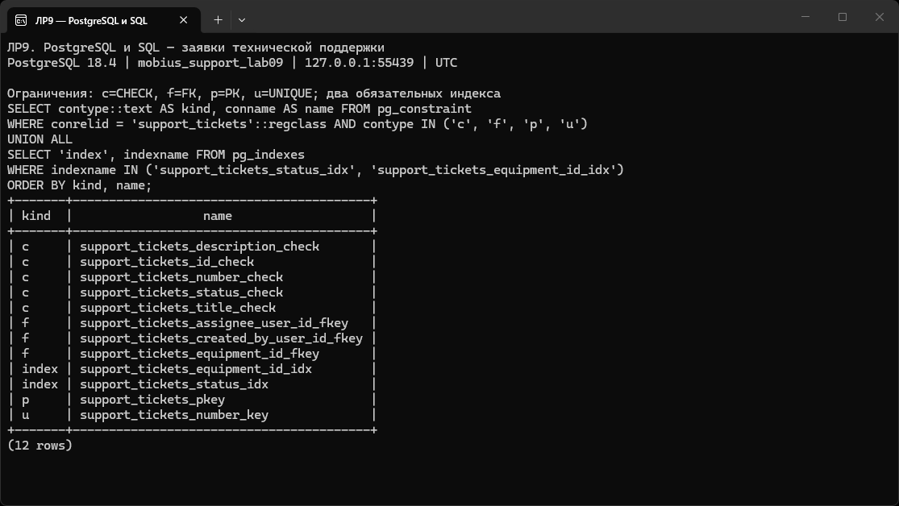
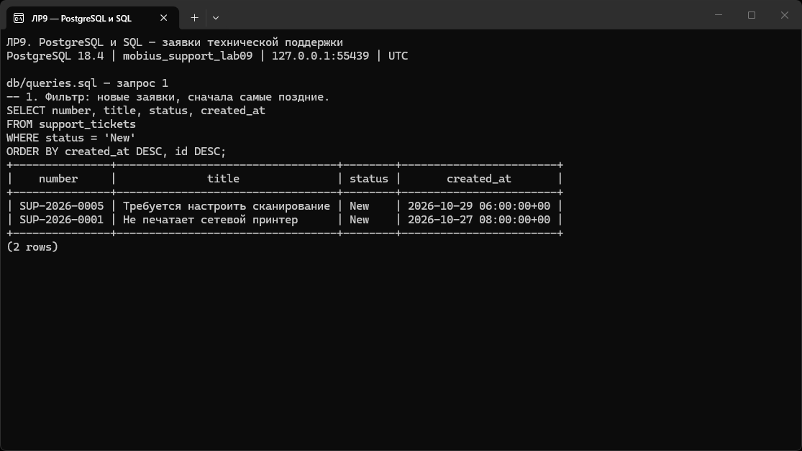
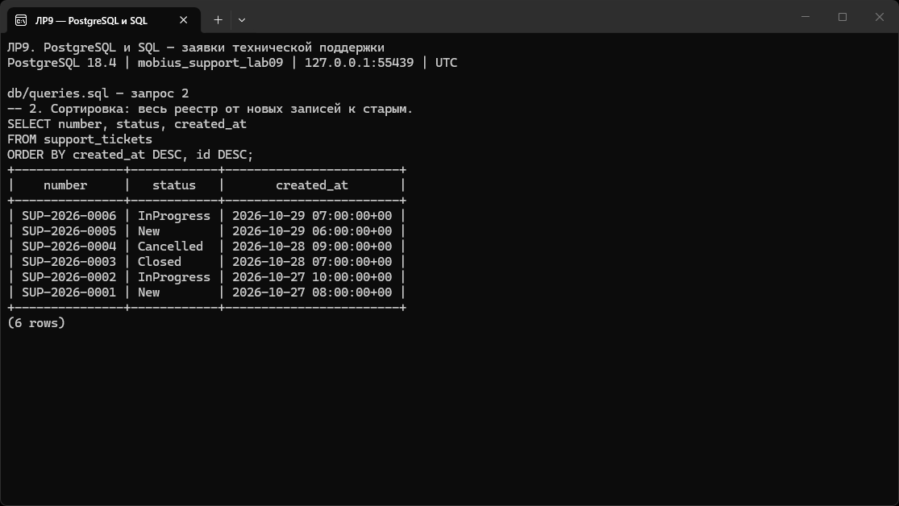
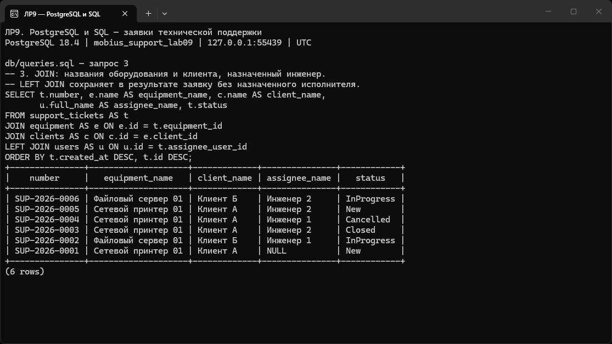
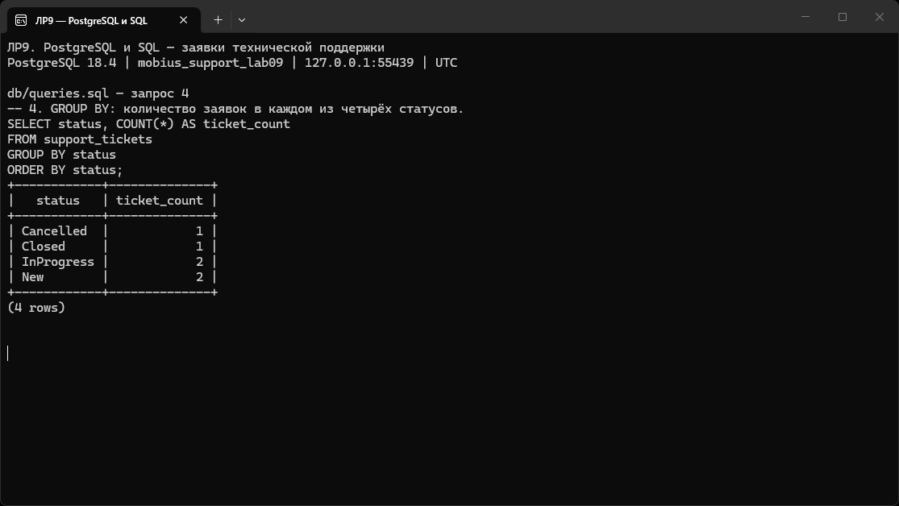
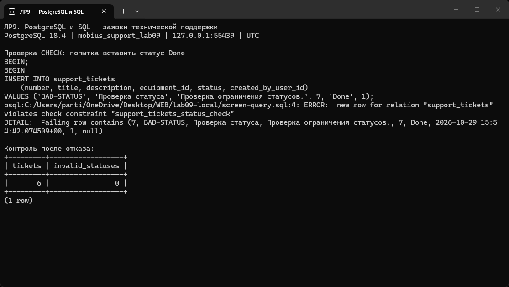
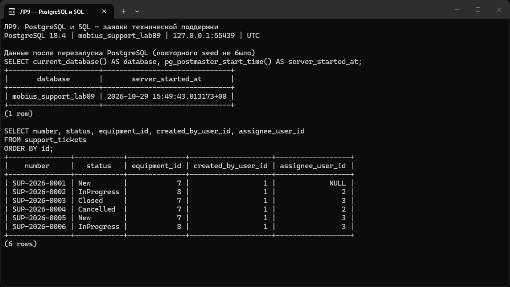

# ЛР9. PostgreSQL и SQL

Студент: Пантин Данил Денисович · Группа: ТРИС-2-23 · Дата: 29.10.2026

## Цель

Создать схему PostgreSQL для системы управления заявками технической поддержки, заполнить её учебными данными и проверить SQL-запросы с фильтром, сортировкой, JOIN и GROUP BY. Убедиться, что ограничения отклоняют неверные данные, а записи сохраняются после перезапуска PostgreSQL.

## Результат

Подготовлены три SQL-файла:

| Файл | Содержание |
|---|---|
| [schema.sql](../../db/schema.sql) | Четыре таблицы, первичные и внешние ключи, UNIQUE, NOT NULL, CHECK и два индекса |
| [seed.sql](../../db/seed.sql) | 2 клиента, 2 единицы оборудования, 3 сотрудника и 6 заявок во всех четырёх статусах |
| [queries.sql](../../db/queries.sql) | Четыре SELECT: фильтр, сортировка, соединение таблиц и подсчёт по статусам |

Проверка выполнена через `psql` на PostgreSQL **18.4**, Windows x64. Использована отдельная учебная база `mobius_support_lab09`, адрес `127.0.0.1:55439`. Существующие службы PostgreSQL не перезапускались. Команды воспроизведения и способ повторной подготовки базы приведены в [README](../../README.md#postgresql-и-sql--лр9).

База на этом этапе проверяется SQL-запросами. Vue и ASP.NET Core продолжают работать в состоянии ЛР8: интерфейс использует mock, API хранит заявки в памяти. Подключение API к PostgreSQL выполняется в следующей лабораторной.

## Схема и соответствие модели ЛР2

| Таблица | Назначение и связи |
|---|---|
| `clients` | Организации-клиенты |
| `equipment` | Оборудование; обязательный `client_id` ссылается на `clients.id` |
| `users` | Сотрудники: Dispatcher или Engineer; отдельные login и password_hash |
| `support_tickets` | Заявки; ссылки на оборудование, автора и необязательного исполнителя |

В заявке хранятся `id`, `number`, `title`, `description`, `equipment_id`, `status`, `created_at`, `created_by_user_id`, `assignee_user_id`. Клиент определяется по цепочке `support_tickets.equipment_id → equipment.client_id → clients.id`. Названия оборудования, клиента и ФИО инженера в заявке не дублируются.

SQL-имена записаны в `snake_case`; соответствие полям JSON и модели описано в [модели данных](../data-model.md#sql-схема-лр9). Например, `equipment_id` соответствует `equipmentId`, `assignee_user_id` — `assigneeUserId`.

Основные ограничения:

- ID — положительный первичный ключ с `GENERATED BY DEFAULT AS IDENTITY`.
- Номер заявки и логин сотрудника уникальны.
- Тема — 5–80 символов, описание — 10–500; текст хранится без пробелов по краям.
- Статус — только `New`, `InProgress`, `Closed`, `Cancelled`; значение по умолчанию — `New`.
- `created_at` имеет тип `timestamptz` и значение по умолчанию `CURRENT_TIMESTAMP`.
- `assignee_user_id` допускает `NULL`; ноль вместо отсутствующего исполнителя не используется.
- Внешние ключи с `ON DELETE RESTRICT` защищают используемые справочники и сотрудников.

Индексы `support_tickets_status_idx` и `support_tickets_equipment_id_idx` предназначены для фильтра по статусу и поиска/соединения по оборудованию. Назначение каждого индекса подписано комментарием в схеме. На шести строках PostgreSQL может выбрать последовательное чтение: наличие индекса не означает, что он обязательно выгоден для маленькой таблицы.

FK подтверждает существование сотрудника. Проверка его роли, доступа к заявке и разрешённых переходов остаётся правилом сервиса из ЛР8. Триггеры переходов статуса в рамках ЛР9 не добавлялись. В `password_hash` записаны учебные хеши ASP.NET Core PasswordHasher; исходные случайные пароли не сохранялись. Настоящий вход в этой работе не реализуется.



## Учебные данные

ID справочников согласованы с ЛР8: клиенты 3 и 4, оборудование 7 и 8, сотрудники 1, 2 и 3. Это учебные данные, не выгрузка из компании.

| Номер | Оборудование | Статус | Исполнитель |
|---|---|---|---|
| SUP-2026-0001 | Сетевой принтер 01 | New | NULL |
| SUP-2026-0002 | Файловый сервер 01 | InProgress | Инженер 1 |
| SUP-2026-0003 | Сетевой принтер 01 | Closed | Инженер 2 |
| SUP-2026-0004 | Сетевой принтер 01 | Cancelled | Инженер 1 |
| SUP-2026-0005 | Сетевой принтер 01 | New | Инженер 2 |
| SUP-2026-0006 | Файловый сервер 01 | InProgress | Инженер 2 |

Автор всех заявок — диспетчер 1. New с назначенным инженером показывает, что назначение не меняет статус. У Cancelled сохранён исполнитель. После вставки явных ID последовательности обновлены через `setval`, чтобы автоматически выдаваемые ID не пересекались с seed.

## Повторный запуск схемы

`schema.sql` выполнен **дважды подряд**, оба запуска завершились COMMIT. Затем выполнен `seed.sql`. [Фактический вывод подготовки](evidence/lab-09/setup.txt).

Пересоздание начинается с зависимой таблицы заявок, затем удаляет оборудование, сотрудников и клиентов. Все операции находятся в одной транзакции, `CASCADE` не используется. Повторная подготовка удаляет учебные строки, поэтому выполнять её следует только в отдельной учебной БД. Для чтения и проверки сохранности схему и seed повторять не нужно.

## Обязательные запросы

Все четыре запроса находятся в `queries.sql`. Результаты получены из настоящей базы через `psql`; ниже приведены снимки окна с выполненным SQL и ответами PostgreSQL. [Полный текстовый вывод](evidence/lab-09/queries.txt).

### 1. Фильтр

`WHERE status = 'New'` вернул две заявки: сначала SUP-2026-0005, затем SUP-2026-0001. Записи упорядочены по убыванию `created_at`; `id` задаёт однозначный порядок при одинаковом времени.



### 2. Сортировка

Все шесть заявок выведены от новых к старым: SUP-2026-0006 … SUP-2026-0001. В выводе время показано в UTC.



### 3. JOIN

Соединение заявок с оборудованием и клиентами показывает названия, а не только ID. `LEFT JOIN users` добавляет имя назначенного инженера и сохраняет в результате заявку без исполнителя: SUP-2026-0001 с NULL. Получено шесть строк.



### 4. GROUP BY

Запрос `GROUP BY status` с `COUNT(*)` вернул все четыре группы:

| Статус | Количество |
|---|---:|
| Cancelled | 1 |
| Closed | 1 |
| InProgress | 2 |
| New | 2 |



## Проверка ограничений

Выполнено **20 проверок, 20 успешных, 0 ошибок проверки**. Это включает ожидаемые отказы PostgreSQL для неверных данных. [Сводка](evidence/lab-09/checks-summary.json), [SQL и полный вывод каждой проверки](evidence/lab-09/constraints.txt).

Проверены количество учебных строк, два индекса, отсутствие дублирующего `client_id` в заявке, недопустимый статус, внешние ключи оборудования/клиента/автора/исполнителя, повтор номера, обязательность оборудования, границы длины текстов, пробелы по краям темы, значения по умолчанию и запрет удаления используемого оборудования. Допустимые границы 5/80 и 10/500 приняты; 4/81 и 9/501 отклонены. После пробных операций осталось шесть исходных заявок.

Обязательная проверка CHECK выполнялась отдельной вставкой, вне рабочего seed:

```sql
BEGIN;
INSERT INTO support_tickets
    (number, title, description, equipment_id, status, created_by_user_id)
VALUES ('BAD-STATUS', 'Проверка статуса', 'Проверка ограничения статусов.', 7, 'Done', 1);
ROLLBACK;
```

PostgreSQL отказал по `support_tickets_status_check`, SQLSTATE `23514`. После ошибки транзакция откатывается; при `psql -v ON_ERROR_STOP=1` подключение завершается и незавершённая транзакция также откатывается. В базе нет записей со статусом Done, число заявок осталось равно 6. Ошибочной вставки в `seed.sql` нет.



## Сохранность после перезапуска PostgreSQL

Получены снимки данных до и после штатной остановки и запуска отдельного учебного экземпляра. В остановленном состоянии `pg_isready` подтвердил отсутствие ответа на порту 55439. После запуска время старта PostgreSQL изменилось. Схема и seed между снимками не выполнялись.

| Проверка | Результат |
|---|---|
| PostgreSQL действительно остановлен и запущен | Время старта изменилось, порт временно не отвечал |
| Количество строк | 2 клиента, 2 оборудования, 3 сотрудника, 6 заявок до и после |
| Все значения строк четырёх таблиц | Контрольная сумма совпала: `03345496801ed518d5e7d13cb79b6d39` |
| Номера, статусы, даты и связи заявок | Сохранены |

[Снимок до](evidence/lab-09/before-restart.json), [снимок после](evidence/lab-09/after-restart.json), [вывод проверки перезапуска](evidence/lab-09/restart.txt). Контрольная сумма рассчитана по упорядоченным строкам всех четырёх таблиц; это проверка равенства данных, не способ хранения паролей.



## Чеклист

- [x] Есть три SQL-файла в `db/` и инструкция запуска в README.
- [x] Схема соответствует модели ЛР2; SQL-имена используют snake_case.
- [x] Есть справочники, сотрудники, заявки, PK, FK, UNIQUE, NOT NULL и CHECK.
- [x] Исполнитель может быть NULL; клиент не дублируется в заявке.
- [x] Два обязательных индекса снабжены комментариями.
- [x] Схема выполнена повторно.
- [x] Seed содержит сотрудников, оборудование и все четыре статуса.
- [x] Выполнены фильтр, сортировка, JOIN с названиями и GROUP BY с COUNT.
- [x] Done отклонён ограничением CHECK; ошибочной вставки в seed нет.
- [x] После перезапуска PostgreSQL данные сохранены без повторного seed.
- [x] В отчёте есть фактические результаты и скриншоты.
- [x] Пароль подключения и каталог данных PostgreSQL находятся вне Git.

## Устная защита

1. **Зачем внешний ключ?** Чтобы нельзя было создать заявку по несуществующему оборудованию или оставить используемый справочник без связанной записи.
2. **Почему название оборудования не хранится в заявке?** Оно принадлежит справочнику. Заявка содержит ссылку, а JOIN получает актуальное название без дублирования.
3. **Чем JOIN отличается от GROUP BY?** JOIN соединяет сведения из таблиц по связям; GROUP BY объединяет строки в группы, после чего COUNT считает их количество.
4. **Зачем индекс по статусу?** Он может ускорить выборку части реестра по статусу. На маленькой таблице планировщик вправе выбрать обычное чтение.
5. **Что означает NULL у исполнителя?** Инженер ещё не назначен; это отсутствие значения, а не пользователь с ID 0.
6. **Почему схема и seed не запускаются при проверке перезапуска?** Иначе данные были бы созданы заново и проверка не доказала бы сохранность.
