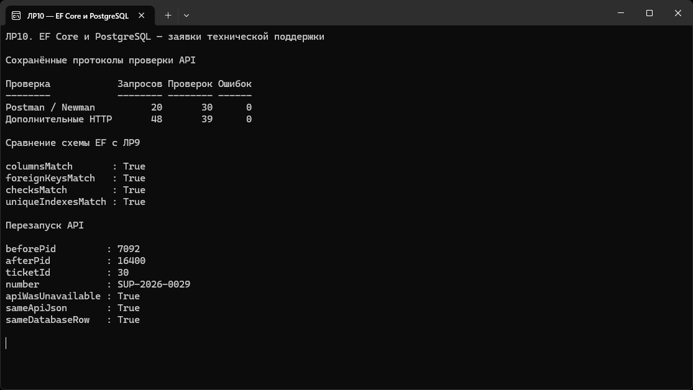
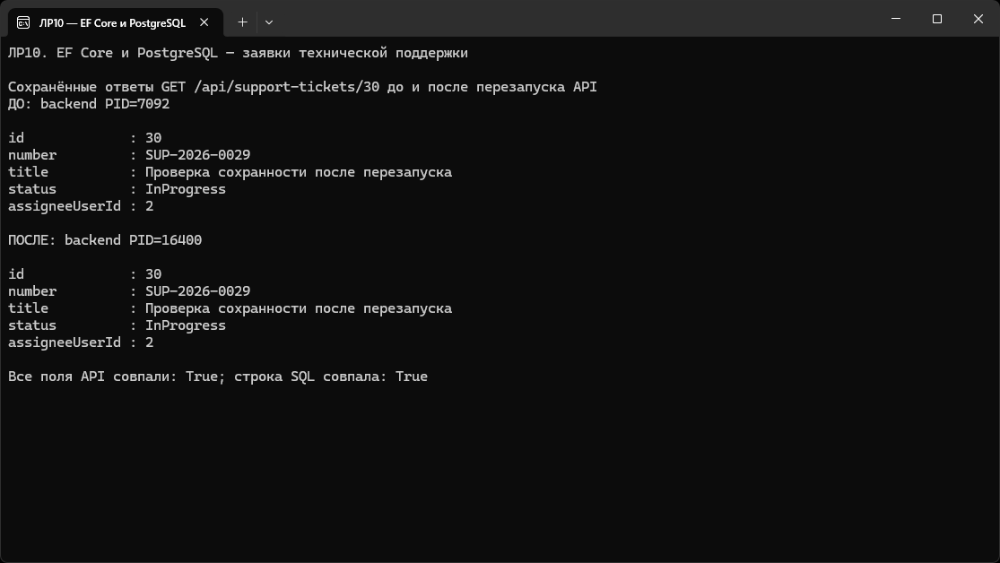
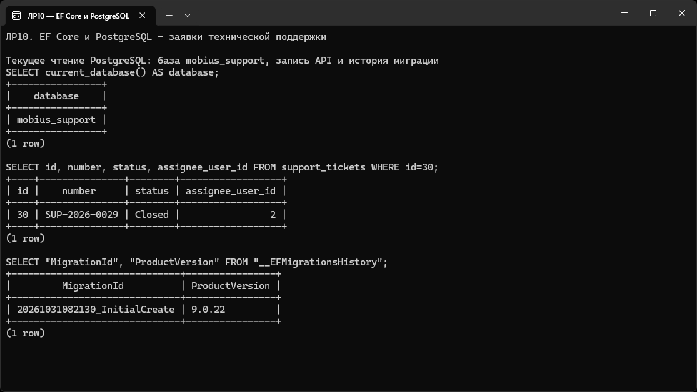
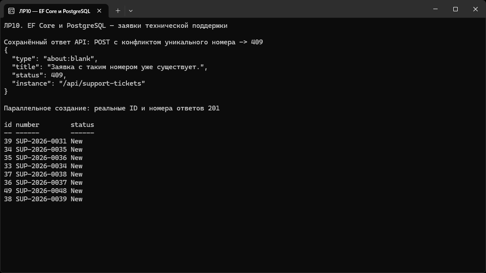

# ЛР10. EF Core и PostgreSQL

Студент: Пантин Данил Денисович · Группа: ТРИС-2-23 · Дата: 31.10.2026

## Цель

Перевести API заявок с хранения в памяти на PostgreSQL через EF Core. Сохранить маршруты, JSON и правила ЛР8, применить миграцию и подтвердить сохранность заявки после перезапуска API.

## Реализация

| Часть | Результат |
|---|---|
| Зависимости | EF Core 9.0.22, Npgsql.EntityFrameworkCore.PostgreSQL 9.0.4, dotnet-ef 9.0.22; проект net9.0 |
| [AppDbContext](../../backend/Data/AppDbContext.cs) | Четыре таблицы, связи, ограничения, индексы и преобразование перечислений в строки |
| [Миграция InitialCreate](../../backend/Migrations/20261031082130_InitialCreate.cs) | Схема, последовательность номеров и начальные справочники |
| [Снимок модели](../../backend/Migrations/AppDbContextModelSnapshot.cs) | Модель для последующих миграций |
| [SupportTicketService](../../backend/Services/SupportTicketService.cs) | Асинхронные чтение и запись через EF вместо List и счётчиков процесса |
| [Program.cs](../../backend/Program.cs) | Регистрация Npgsql, DbContext и сервиса на время HTTP-запроса |

Инструмент EF закреплён в [.config/dotnet-tools.json](../../.config/dotnet-tools.json). Строка подключения по ключу `ConnectionStrings:Default` сохранена в user-secrets вне репозитория. В отслеживаемых конфигурациях находится пустой ключ без пароля. [Команды запуска](../../README.md#подключение-api-к-postgresql).

Миграция применена к отдельной пустой учебной БД `mobius_support` на PostgreSQL 18.4. Созданы 2 клиента, 2 единицы оборудования и 3 сотрудника с прежними ID. Заявки начальной миграцией не создаются. `ReferenceData` используется только для данных миграции; при обработке запросов справочники читаются из PostgreSQL.

`db/schema.sql`, `seed.sql`, `queries.sql` сохранены как материалы ЛР9. Для базы API используется `dotnet ef database update`, а не ручное пересоздание таблиц этими скриптами.

## Соответствие SQL-схеме

| C# | PostgreSQL |
|---|---|
| Client.Id / Name | clients.id / name |
| Equipment.ClientId | equipment.client_id |
| User.FullName / PasswordHash | users.full_name / password_hash |
| SupportTicket.EquipmentId | support_tickets.equipment_id |
| SupportTicket.CreatedByUserId | support_tickets.created_by_user_id |
| SupportTicket.AssigneeUserId | support_tickets.assignee_user_id |
| SupportTicket.CreatedAt | support_tickets.created_at |

Остальные имена настроены в `AppDbContext` по тем же правилам. `SupportTicketStatus` хранится как New, InProgress, Closed или Cancelled; `UserRole` — Dispatcher или Engineer. Исполнитель допускает NULL, время хранится как timestamptz. Клиент по-прежнему определяется через оборудование.

Сравнение фактических схем ЛР9 и EF подтвердило совпадение столбцов с типами и обязательностью, внешних ключей, CHECK и уникальных индексов. [Результат сравнения](evidence/lab-10/schema-comparison.json). EF также создаёт индексы внешних ключей по своим соглашениям. Таблица `__EFMigrationsHistory` и последовательность человеческих номеров относятся к работе миграций и API.

ID формируется identity-столбцом. Человеческий номер вида `SUP-2026-0029` использует отдельную последовательность PostgreSQL. Она сохраняется после рестарта и выдаёт разные значения параллельным POST. Пропуски после отказов допустимы. Уникальный индекс номера остаётся последней проверкой БД; конфликт преобразуется в HTTP 409.

Назначение и смена статуса выполняются в транзакции с блокировкой строки `FOR UPDATE`: проверка состояния и сохранение изменения не расходятся при параллельных PATCH. Чтение одной заявки проверяет доступ по тому же результату SQL, который возвращается клиенту.

## Сборка и миграции

Сборка завершилась с **0 предупреждений и 0 ошибок**. Применена `20261031082130_InitialCreate`. Повторное обновление сообщает, что база актуальна; проверка модели не обнаружила изменений без миграции.

- [Сборка](evidence/lab-10/build.txt).
- [Первое применение миграции](evidence/lab-10/migration.txt).
- [Повторный database update](evidence/lab-10/migration-repeat.txt).
- [Проверка согласованности модели](evidence/lab-10/model-check.txt).

При первом применении EF проверяет ещё отсутствующую `__EFMigrationsHistory`, затем создаёт её и применяет миграцию. Эта начальная проверка отражена в протоколе; команда завершилась успешно.

## Проверка API

Коллекция Postman выполнена через Newman на новой базе после миграции: **20 запросов, 30 проверок, 0 ошибок**. [Сводка](evidence/lab-10/newman-summary.json). Условие первого запроса уточнено: база ещё не содержит заявок; один перезапуск API больше не делает список пустым.

На итоговом коде дополнительно выполнены **48 HTTP-запросов и 39 успешных проверок, 0 ошибок проверки**. [Сводка](evidence/lab-10/http-summary.json), [методы, тела запросов и фактические ответы](evidence/lab-10/http-requests.json).

| Сценарий | Результат |
|---|---|
| POST корректной заявки | 201, Location, серверные ID/номер, New и пустой исполнитель |
| Список и заявка по ID | 200, данные PostgreSQL |
| Отсутствующий ID | 404 |
| Неверные поля, строка вместо числового equipmentId, неизвестная ссылка | 400 |
| Заголовок сотрудника отсутствует или ID неизвестен | 400 |
| Создание инженером, чужая заявка, недопустимое действие | 409 |
| Назначение | Исполнитель сохранён, статус остался New |
| Начало и завершение работы | Сохранены InProgress и затем Closed |
| Переназначение в работе, изменение конечного статуса | 409, данные сохранены |
| DELETE и общий PATCH | 405 |
| Ответ заявки | Без login и passwordHash |

Временный X-User-Id сохраняется до лабораторной с настоящим входом. Контракты пяти операций и правила ролей не заменялись авторизацией будущего этапа. Vue продолжает использовать mock.



## Обязательная проверка перезапуска API

Через POST создана заявка, затем отдельными PATCH назначен инженер 2 и установлен InProgress. Выполнен GET и сохранён ответ. Процесс API остановлен; `/health` временно недоступен. После повторного `dotnet run` выполнен GET по тому же ID. PostgreSQL при этой проверке продолжал работать; миграция и seed повторно не выполнялись.

| Поле | До остановки API | После запуска API |
|---|---|---|
| PID процесса backend | 7092 | 16400 |
| id | 30 | 30 |
| number | SUP-2026-0029 | SUP-2026-0029 |
| title | Проверка сохранности после перезапуска | Проверка сохранности после перезапуска |
| status | InProgress | InProgress |
| assigneeUserId | 2 | 2 |

Совпали все поля JSON, включая описание, оборудование, клиента, автора и дату. Прямое чтение SQL подтвердило ту же строку до и после рестарта.

- [HTTP до](evidence/lab-10/before-api-restart.json), [HTTP после](evidence/lab-10/after-api-restart.json).
- [SQL до](evidence/lab-10/db-before-restart.json), [SQL после](evidence/lab-10/db-after-restart.json).
- [Сводка перезапуска](evidence/lab-10/restart-summary.json).

Ниже показано окно просмотра сохранённых HTTP-ответов до и после перезапуска; это не снимок Swagger.



После проверки сохранности отдельным запросом проверено завершение этой заявки: её текущий статус стал Closed. Поэтому последующее чтение SQL ниже показывает Closed, а снимки момента перезапуска — InProgress.



## Параллельные операции и конфликт номера

При 20 одновременных POST все ответы получили 201; все ID и номера различны. [Полученные записи](evidence/lab-10/parallel-created.json).

Одновременные переназначение и начало работы завершились допустимым сочетанием ответов и состояния: либо переназначение успело первым и прежний инженер получил отказ, либо работа началась и переназначение было отклонено. [Фактические ответы и конечная запись](evidence/lab-10/parallel-patch.json).

Для проверки конфликта в учебную БД временно вставлена строка с номером, который должен следующим выдать счётчик. POST получил **409**, а не 500. Временная строка после проверки удалена SQL-командой; маршрут DELETE в API не добавлялся. [Ответ 409](evidence/lab-10/duplicate-number-409.json).



## LINQ и соответствующий SQL

Фильтр в сервисе, где `filter` равен `SupportTicketStatus.New`:

```csharp
tickets = tickets.Where(item => item.Status == filter);
```

Его смысл на SQL, знакомом по ЛР9:

```sql
SELECT *
FROM support_tickets
WHERE status = 'New';
```

Фактический запрос EF дополнительно соединяет оборудование, клиента и исполнителя, выбирает поля DTO и передаёт значение статуса параметром. [SQL из журнала EF](evidence/lab-10/ef-filter-sql.txt).

## Чеклист

- [x] Подключены совместимые EF Core, Npgsql и dotnet-ef.
- [x] Созданы DbContext, InitialCreate и снимок модели.
- [x] Миграция применена и повторно проверена.
- [x] Схема и ограничения согласованы с ЛР9.
- [x] POST, оба GET и оба PATCH используют PostgreSQL.
- [x] Сохранены поля JSON, коды и правила ЛР8; отсутствующий ID даёт 404.
- [x] Конфликт номера даёт 409.
- [x] Один и тот же ID и остальные поля сохранены после перезапуска API.
- [x] В отчёте есть результаты, скриншоты и пара LINQ / SQL.
- [x] Настоящая строка подключения находится вне репозитория.

## Устная защита

1. **Что делает EF Core?** Переводит запросы и изменения C# в SQL и выполняет их в PostgreSQL. Данные принадлежат базе, а не списку процесса.
2. **Зачем DbContext?** Он задаёт таблицы, связи и настройки сущностей, выполняет запросы и сохраняет изменения через SaveChangesAsync.
3. **Чем миграция отличается от schema.sql?** SQL-файл ЛР9 описывает учебную схему целиком; миграции хранят последовательность изменений модели и учитывают уже выполненные шаги в истории БД.
4. **Где пароль?** В user-secrets вне Git; в репозитории только пустой ключ настройки.
5. **Почему заявка сохранилась после рестарта?** POST и PATCH записали изменения в PostgreSQL, а новый процесс API прочитал ту же запись по её ID.
6. **Почему номер не повторился после рестарта?** Счётчик — отдельная последовательность PostgreSQL, а уникальный индекс запрещает дублирование number.
