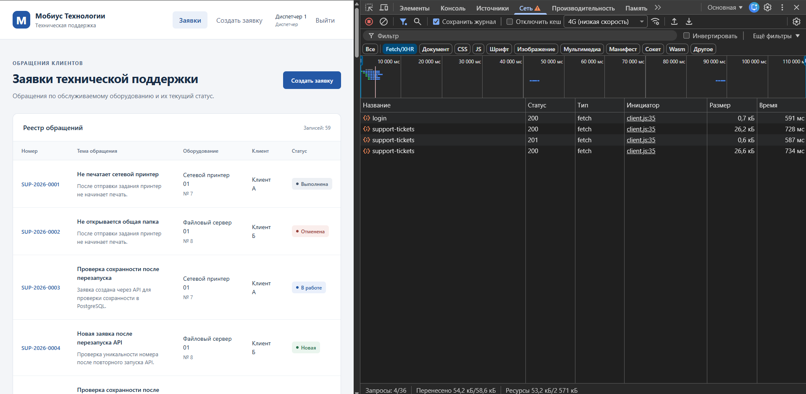
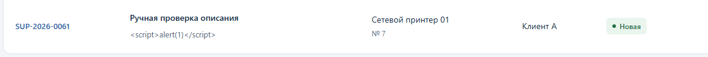

# ЛР11. Вход и права

Студент: Пантин Данил Денисович · Группа: ТРИС-2-23 · Дата: 02.11.2026

## Цель

Добавить настоящий вход и серверное разграничение прав диспетчера и инженера. Хранить пароли как библиотечные хеши, различать 401 и 403, безопасно выводить описание заявки во Vue.

## Реализация

Выбран один способ входа: учебный JWT в заголовке `Authorization: Bearer <accessToken>`.

| Часть | Реализация |
|---|---|
| Вход | [AuthController](../../backend/Controllers/AuthController.cs), `POST /api/auth/login` и `GET /api/auth/me` |
| Пароли и токен | [AuthService](../../backend/Auth/AuthService.cs), ASP.NET Identity `PasswordHasher<User>`, JWT HS256 на 30 минут |
| Проверка токена | [Program.cs](../../backend/Program.cs): подпись, алгоритм, issuer, audience, срок, существующий сотрудник и актуальная роль |
| Текущий сотрудник | [CurrentUser](../../backend/Auth/CurrentUser.cs), ID из проверенного `sub`; заголовок `X-User-Id` не используется |
| Права на заявку | [SupportTicketService](../../backend/Services/SupportTicketService.cs): роль, назначенный инженер, разрешённые переходы |
| Экран входа | [Login.vue](../../frontend/src/pages/Login.vue): реальные запросы, ошибки, блокировка повторной отправки |
| Сеанс клиента | [session.js](../../frontend/src/auth/session.js), [auth.js](../../frontend/src/api/auth.js): sessionStorage, восстановление профиля, выход и обработка 401 |
| Описание | [TicketTable.vue](../../frontend/src/components/TicketTable.vue): `{{ item.description }}` без `v-html` |
| Документация | [Матрица ролей](../role-matrix.md), [порядок запуска и учебные учётки](../../README.md#вход-и-права) |

Диспетчер создаёт заявки, назначает инженера при New и отменяет New/InProgress. Инженер получает только свои заявки и переводит их New → InProgress → Closed. Чужая заявка и запрещённое роли действие дают 403. Разрешённое роли действие в неподходящем состоянии даёт 409. Closed и Cancelled окончательны; отмена сохраняет исполнителя.

Проверки выполняются сервером независимо от кнопок. Скрытие создания и защита маршрута `/new` во Vue дополняют серверные правила.

## Учебные данные и сохранность

Миграция [DemoUserPasswords](../../backend/Migrations/20261102135846_DemoUserPasswords.cs) обновляет только `password_hash` трёх существующих учебных сотрудников. Начальная миграция ЛР10 сохранена. ID, связи и заявки не пересоздаются.

До и после обновления в существующей БД было 50 заявок; отпечаток полного содержимого совпал: `5bd4dad69f2ebf5101e24de31aaf6bf0`. Затем проверки добавили собственные учебные заявки. На отдельной новой БД обе миграции создали 2 клиента, 2 единицы оборудования, 3 сотрудников и 0 заявок; повторный `database update` завершился без повторного заполнения. [Результат](evidence/lab-11/database-summary.json).

В `users.password_hash` находятся разные хеши длиной 84 символа, созданные PasswordHasher с солью. Успешный вход каждого сотрудника и отказ при неверном пароле проверены через HTTP. [Значения учебных хешей из БД](evidence/lab-11/database-users.json). Исходные учебные пароли приведены в README; они не являются паролем PostgreSQL.

Ключ подписи и пароль БД хранятся вне Git. [Проверка файлов](evidence/lab-11/secret-scan.json) не обнаружила их или действительные JWT в исходниках и доказательствах.

## Выполненные проверки

| Проверка | Результат | Доказательство |
|---|---|---|
| Сборка backend | 0 предупреждений, 0 ошибок | [backend-build.txt](evidence/lab-11/backend-build.txt) |
| Сборка Vue | Успешно | [frontend-build.txt](evidence/lab-11/frontend-build.txt) |
| HTTP-сценарии | 113 запросов, 269 проверок, 0 ошибок | [Сводка](evidence/lab-11/http-summary.json), [запросы и ответы](evidence/lab-11/http-requests.json) |
| Коллекция Postman/Newman | 54 запроса, 124 проверки, 0 ошибок | [Сводка](evidence/lab-11/newman-summary.json) |
| Повторный Newman на той же БД | 54 запроса, 124 проверки, 0 ошибок | [Повторный прогон](evidence/lab-11/newman-repeat-summary.json) |
| JWT, CORS и Swagger | 17 сценариев пройдены | [security-summary.json](evidence/lab-11/security-summary.json) |
| Гонки сеанса и вывод Vue | 8 тестов пройдены | [frontend-tests.txt](evidence/lab-11/frontend-tests.txt) |
| Модули Vue с настоящим API, без браузера | 9 проверок, 7 HTTP-запросов, 0 ошибок | [frontend-integration.json](evidence/lab-11/frontend-integration.json) |
| Ручной сценарий в Chrome | Проверил вход, создание, XSS, F5 и права инженера | [Результаты](evidence/lab-11/manual-checks.json), снимки ниже |

HTTP-проверки подтверждают:

- POST, чтение и PATCH без входа дают 401; один `X-User-Id` не заменяет вход.
- Инженер не создаёт, не назначает и не отменяет; другой инженер не читает и не меняет чужую заявку: 403, данные сохраняются.
- Вошедший диспетчер создаёт с 201; назначенный инженер выполняет разрешённые переходы с 200.
- Подмена `X-User-Id` не меняет автора или права. Фильтр не раскрывает чужие заявки.
- Неверные поля дают 400, отсутствующий ID — 404, недопустимое состояние — 409. DELETE и общего PATCH нет.
- Испорченный, просроченный, неподписанный токен, неверные issuer/audience/алгоритм, несуществующий сотрудник или устаревшая роль дают 401.
- Неверный пароль и неизвестный логин возвращают одинаковую ошибку. Пароль не обрезается по краям; хеш не выдаётся клиенту.

Тесты клиента удерживают чтение ответа и меняют сеанс в этот момент. Запоздавший 200 не возвращает старый список, запоздавший 401 не завершает новый вход, поздний ответ входа не восстанавливает сеанс после выхода. Отдельный тест настоящего TicketList воспроизводит одновременное завершение нового входа и старой загрузки: перед записью списка и обработкой ошибки повторно проверяется поколение сеанса.

Компонентный тест загружает настоящий TicketTable.vue и проверяет строку `<script>alert(1)</script>`: серверный рендер Vue создаёт `&lt;script&gt;alert(1)&lt;/script&gt;`, элемента `script` в результате нет. Это проверка компонента, а не визуальное прохождение в браузере.

Интеграционный скрипт загружает настоящие модули клиента и обращается к запущенному API: входит диспетчером, создаёт заявку `62 / SUP-2026-0060`, читает её и передаёт полученное описание в настоящий компонент Vue. Затем проверяет восстановление хранилища новым графом модулей через реальный `GET /api/auth/me`, выход, неверный пароль и запрет создания инженером. Хранилище и перезагрузка моделируются в Node; браузер и DOM не запускаются.

Воспроизведение при запущенных PostgreSQL и API:

```powershell
node scripts/verify-lab11.mjs
npm exec --yes --package=newman -- newman run docs/api-collection/support-tickets.postman_collection.json
cd frontend
npm test
npm run test:integration
npm run build
```

Проверки HTTP создают собственные строки и допускают заполненную БД. Токены и значения паролей удаляются до сохранения публичных результатов; полный Newman-отчёт с ответами входа в Git не включается.

## Ручная проверка в Chrome

02.11.2026 проверил в Chrome вход, создание заявки, безопасный вывод описания, сохранение сеанса после обновления страницы и ограничения инженера. [Результаты ручной проверки](evidence/lab-11/manual-checks.json) и скриншоты приведены ниже.

| Действие | Результат | Способ проверки |
|---|---|---|
| Вход как `dispatcher1` | `login` → 200, список → 200 | Network на снимках |
| Создание заявки | `support-tickets` → 201, повторная загрузка → 200 | Network и новая строка в реестре |
| Вывод описания | `<script>alert(1)</script>` виден текстом | Снимки заявки `SUP-2026-0061` |
| Отсутствие исполнения скрипта | Диалог alert не появился | Проверил визуально |
| Обновление страницы F5 | Вход и созданная заявка сохранились | Проверил после обновления страницы |
| Вход как `engineer1` | Кнопки создания нет; прямой `/new` возвращает в список с сообщением об отсутствии прав | Проверил интерфейс и прямой переход по адресу |

Вход и создание через настоящий API:



[Крупный план списка запросов Network](images/lab-11/manual-network-detail.png).

Создал заявку `SUP-2026-0061` с темой «Ручная проверка описания», оборудованием 7 и статусом New. В её описании видна точная проверочная строка:



[Общий фрагмент реестра с созданной заявкой](images/lab-11/manual-xss-list.png), [форма входа](images/lab-11/login.png).

## К защите

- **401 и 403:** в первом случае нет действительного входа, во втором сотрудник известен, но действие или объект ему запрещены.
- **Почему не Base64 пароля:** кодирование обратимо; PasswordHasher сохраняет результат одностороннего вычисления с солью и стоимостью. Текстовое представление самого хеша не является исходным паролем.
- **Где проверяется чужой ID:** в сервисе сравниваются текущий инженер и `AssigneeUserId`; список сразу фильтруется по этому ID.
- **Почему скрытая кнопка не защита:** прямой HTTP-запрос проходит те же серверные проверки и получает 403.
- **Почему описание безопасно:** Vue выводит его текстовым узлом через интерполяцию и не интерпретирует как HTML.
