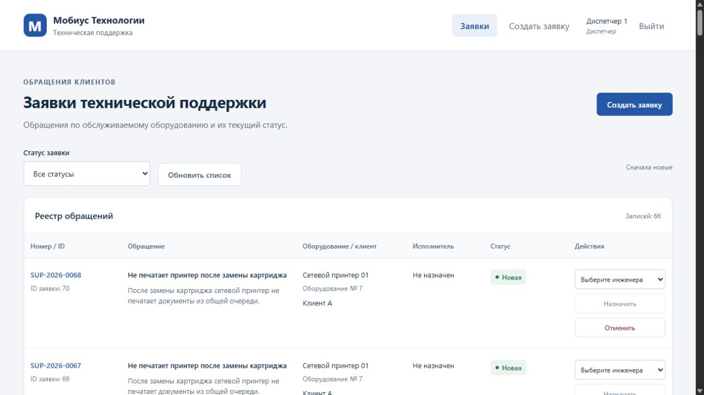
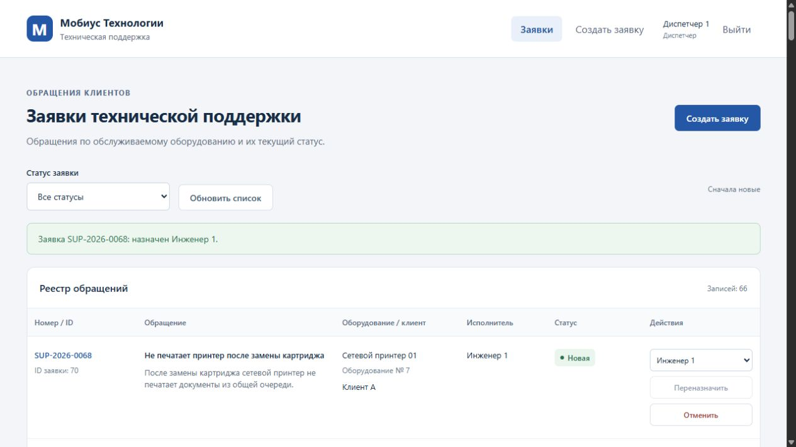
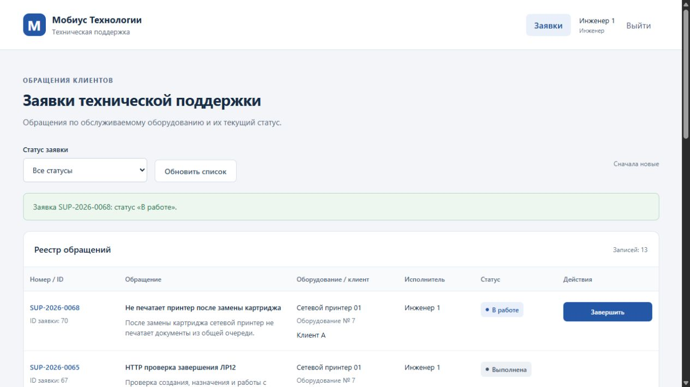
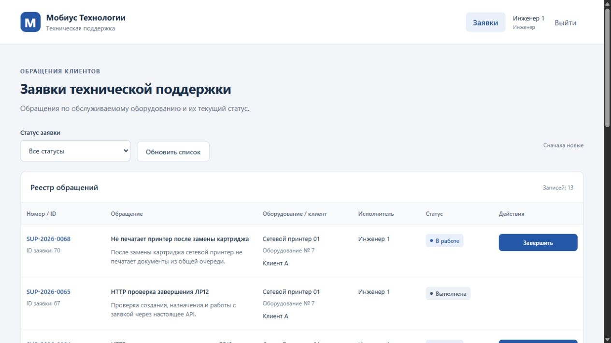

# ЛР12. Сквозная сборка

Студент: Пантин Данил Денисович · Группа: ТРИС-2-23 · Дата: 02.11.2026

## Цель

Собрать Vue, ASP.NET Core и PostgreSQL в единый сценарий: создать заявку через интерфейс, назначить инженера, войти исполнителем и перевести ту же заявку в работу. Сопоставить ID и номер на экране, в HTTP-ответах и SQL, проверить сохранность после перезапуска API.

## Реализация

| Часть | Результат |
|---|---|
| [TicketList.vue](../../frontend/src/pages/TicketList.vue) | Настоящий реестр, фильтр статуса, назначение и действия по роли; обновление по ответу API |
| [TicketTable.vue](../../frontend/src/components/TicketTable.vue) | Явные ID и номер заявки, исполнитель, выбор инженера, разрешённые действия |
| [TicketNew.vue](../../frontend/src/pages/TicketNew.vue) | Оборудование из API, загрузка/ошибка/пустота, повторная загрузка, блок повторного POST |
| [tickets.js](../../frontend/src/api/tickets.js) | GET/POST и отдельные PATCH assignee/status, серверный фильтр |
| [references.js](../../frontend/src/api/references.js) | Оборудование и инженеры через API |
| [EquipmentController](../../backend/Controllers/EquipmentController.cs) | Оборудование с клиентом через EF JOIN, только диспетчер |
| [UsersController](../../backend/Controllers/UsersController.cs) | ID и имена инженеров из PostgreSQL, только диспетчер |

Обычный режим использует API на 5000; Vue работает на 5173. CORS разрешает конкретный origin `http://localhost:5173`. Учебный mock доступен только явно в dev. JWT, миграции и серверные правила предыдущих работ сохранены; новая миграция для ЛР12 не требуется.

В интерфейсе диспетчер назначает/переназначает только New и отменяет New/InProgress. Назначенный инженер берёт свою New в работу и завершает InProgress. У Closed/Cancelled действий нет. Все запреты независимо проверяет сервер. [Матрица ролей](../role-matrix.md).

## Сквозной сценарий

Для проверки использована одна заявка:

| Поле | Значение |
|---|---|
| ID | 70 |
| Номер | SUP-2026-0068 |
| Тема | Не печатает принтер после замены картриджа |
| Оборудование / клиент | 7 / 3, Сетевой принтер 01 / Клиент А |
| Автор | 1, диспетчер |
| Назначенный инженер | 2, Инженер 1 |
| Итоговый статус | InProgress, «В работе» |

Создание выполнено из формы Vue после входа диспетчером. Сервер вернул 201, назначил ID/номер и New без исполнителя. [Ответ POST](evidence/lab-12/created-response.json).



В этой строке выбран Инженер 1 и выполнено назначение отдельным PATCH. Ответ 200 сохранил ID, номер и New, установил исполнителя 2. [Ответ assignee](evidence/lab-12/assigned-response.json).



После выхода и второго входа как `engineer1` выполнено «Взять в работу». Отдельный PATCH status вернул 200 и InProgress с теми же исходными полями. [Ответ status](evidence/lab-12/in-progress-response.json).



Фактические HTTP-запросы и ответы, отправленные клиентом из браузера, сохранены в [журнале браузера](evidence/lab-12/browser-http.json). В журнал входят метод, URL, код, тело действия и ответ заявки. Для списков сохранены количество строк и выбранная заявка 70. Пароли, JWT и заголовки авторизации не записывались. Снимки показывают настоящий интерфейс Chromium.

## Сверка PostgreSQL и перезапуск

```sql
SELECT id, number, title, status, assignee_user_id
FROM support_tickets
WHERE id = 70;
```

Прямое чтение БД подтвердило тот же ID, номер, InProgress и исполнителя 2. Сохранены также описание, оборудование, автор и время создания: [SQL до](evidence/lab-12/database-before-restart.json), [SQL после](evidence/lab-12/database-after-restart.json).

API остановлен и запущен снова: PID изменился с 11488 на 20352, между запусками `/health` был недоступен. PostgreSQL продолжал работать. Схема, seed и миграции при проверке не выполнялись. После обновления браузера та же заявка осталась в работе. Полный ответ API и строка SQL совпали до и после перезапуска: [сводка](evidence/lab-12/browser-summary.json), [ответ после запуска](evidence/lab-12/after-restart-response.json).



## Проверки и документация

- Backend собран без предупреждений и ошибок: [результат](evidence/lab-12/backend-build.txt).
- Выполнены 70 HTTP-запросов и 187 проверок без ошибок: [сводка](evidence/lab-12/http-summary.json), [запросы и ответы](evidence/lab-12/http-requests.json).
- Регрессионная коллекция Newman: 54 запроса, 124 проверки, 0 ошибок: [сводка](evidence/lab-12/newman-summary.json).
- Vue: 25 тестов, 0 ошибок; проверены роли, состояния, справочники, двойная отправка, гонки фильтра и поздние ответы после выхода или ухода со страницы: [тесты](evidence/lab-12/frontend-tests.txt).
- Сборка Vue завершилась успешно: [результат](evidence/lab-12/frontend-build.txt).
- Настоящие модули Vue с работающим API: 11 проверок без ошибок; создание, назначение, второй вход, InProgress и отказ чужому инженеру. Это отдельный автоматизированный прогон без браузера: [результат](evidence/lab-12/frontend-integration.json).
- На чистой копии исходников без node_modules, bin, obj и локального .env восстановлены зависимости, применены миграции к новой БД, собран клиент и запущен отдельный API. Успешны health, вход и чтение двух справочников; начальные заявки отсутствуют. Для изоляции этот проверочный API использовал порт 5001, основной стенд сохранил 5173/5000: [результат подготовки](evidence/lab-12/clean-setup-summary.json).
- [Три критерия приёмки](../acceptance-check.md) сопоставляют шаги с ожидаемыми и фактическими результатами.
- [README](../../README.md) описывает версии, подготовку БД, секреты, миграции, запуск, адреса, учебные учётки и сценарий проверки.
- [Известные ограничения](../known-defects.md) отделяют результаты проверок от ещё не выполненных проверок.

Сам проверил запуск проекта и основной сценарий работы — всё работает. Проверка другим человеком по README не выполнялась.

## К защите

- **Как доказать, что это одна заявка?** Сопоставить ID 70 и номер SUP-2026-0068 в UI, ответах POST/PATCH/GET и SELECT.
- **Почему после назначения статус ещё New?** Назначение и начало работы — разные действия и права; в работу переводит только назначенный инженер.
- **Как отличить CORS от 500?** При CORS браузер блокирует чтение ответа с другого origin; 500 — фактический код ошибки сервера. Разрешён только origin клиента на 5173.
- **Почему запись пережила рестарт?** Изменения записаны в PostgreSQL, а новый процесс API прочитал ту же строку.
